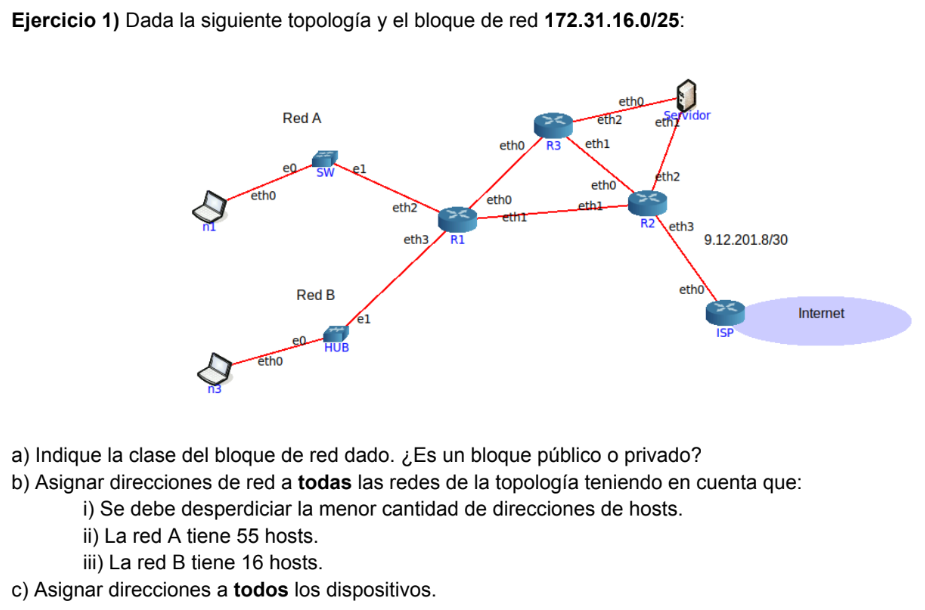
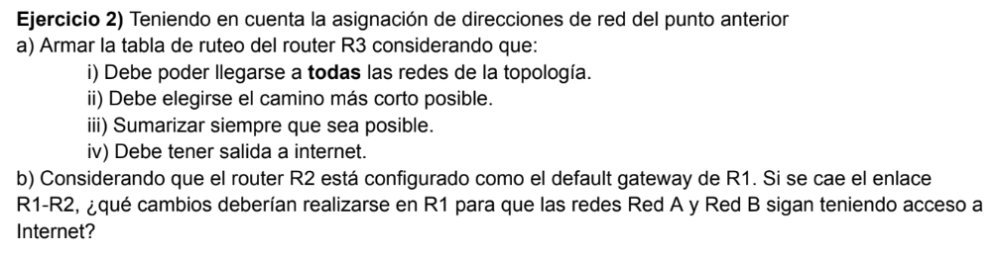
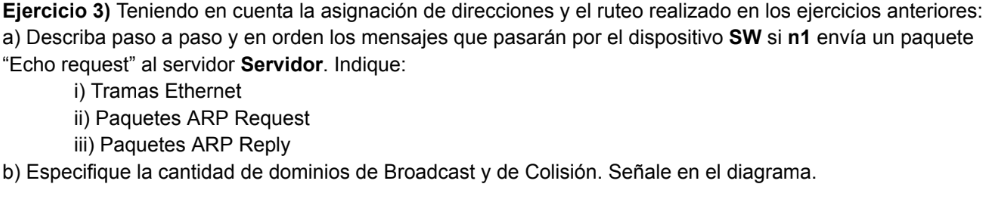
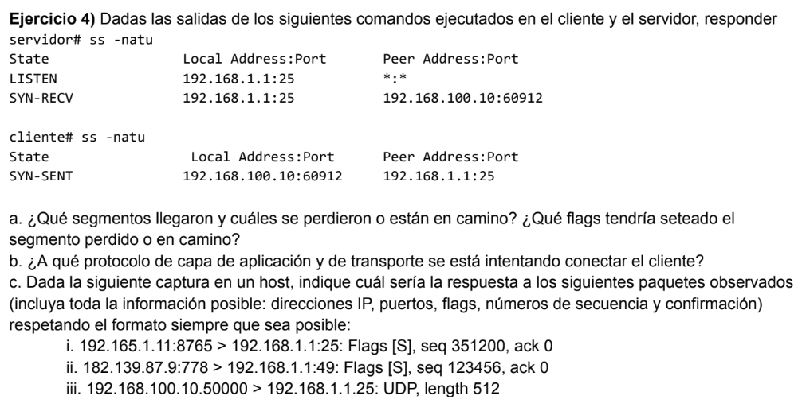
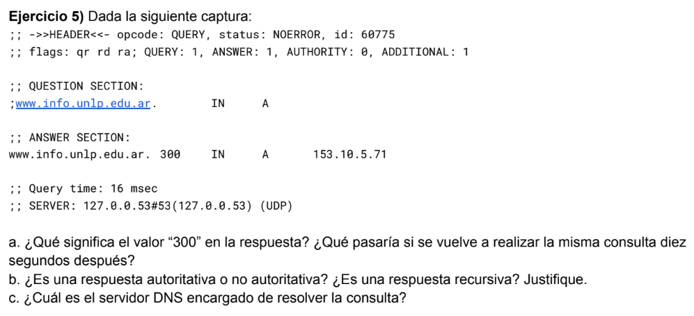
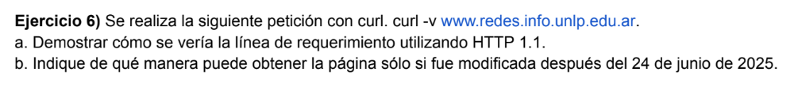

# Redes y Comunicaciones – Parcial 3ra fecha – 04/08/2025

a)172 = 10101100. Al empezar con 10 es de clase B.  
Es un bloque privado ya que esta contenido en el rango 172.16.0.0 - 172.31.255.255.  
b)Partiendo del bloque 172.31.16.0/25…

- Red A (55 hosts):
  - Bits de host: 6 (26 - 2 = 62 \>= 55)
  - Máscara /26
  - <pre>172.31.16.0|<b>0</b>   |000000
               /25  /26</pre>
    - (0) → 172.31.16.0/26 → Red A
    - (1) → 172.31.16.64/26
- Red B (16 hosts):
  - Bits de host: 5 (25 - 2 = 30 \>= 16)
  - Máscara /27
  - <pre>172.31.16.01|<b>0</b>    |00000
                /26   /27</pre>
    - (0) → 172.31.16.64/27 → Red B
    - (1) → 172.31.16.96/27
- P2P R1-R2 (2 hosts):
  - Bits de host: 2
  - /30
  - <pre>172.31.16.011|<b>000</b>|00
                 /27 /30</pre>
    - (000) → 172.31.16.96/30 → P2P R1-R2
    - (001) → 172.31.16.100/30 → P2P R1-R3
    - (010) → 172.31.16.104/30 → P2P R2-R3
    - (011) → 172.31.16.108/30 → Red R3-Servidor
    - (100) → 172.31.16.112/30 → Red R2-Servidor
    - (101) → 172.31.16.116/30
    - (110) → 172.31.16.120/30
    - (111) → 172.31.16.124/30
- P2P R1-R3 (2 hosts):
  - Bits de hosts: 2
  - Máscara: /30
  - Utilizamos red libre 172.31.16.100/30 → P2P R1-R3
- P2P R2-R3 (2 hosts):
  - Bits de hosts: 2
  - Máscara: /30
  - Utilizamos red libre 172.31.16.104/30 → P2P R2-R3
- Red R3-Servidor (2 hosts):
  - Máscara: /30
  - Utilizamos red libre 172.31.16.108/30 -\> Red R3-Servidor
- Red R2-Servidor (2 hosts):
  - Máscara: /30
  - Utilizamos red libre 172.31.16.112/30 -\> Red R2-Servidor
- 9.12.201.8/30 → P2P R2-ISP (ya asignada)

c)

- 172.31.16.0/26 → Red A
  - R1 (eth2): 172.31.16.1
  - n1 (eth0): 172.31.16.2
  - Rango libre: 172.31.16.3 - 172.31.16.62
  - Broadcast: 172.31.16.63
- 172.31.16.64/27 → Red B
  - R1 (eth3): 172.31.16.65
  - n3 (eth0): 172.31.16.66
  - Rango libre: 172.31.16.67 - 172.31.16.94
  - Broadcast: 172.31.16.95
- 172.31.16.96/30 → P2P R1-R2
  - R1 (eth1): 172.31.16.97
  - R2 (eth1): 172.31.16.98
  - Broadcast: 172.31.16.99
- 172.31.16.100/30 → P2P R1-R3
  - R1 (eth0): 172.31.16.101
  - R3 (eth0): 172.31.16.102
  - Broadcast: 172.31.16.103
- 172.31.16.104/30 → P2P R2-R3
  - R2 (eth0): 172.31.16.105
  - R3 (eth1): 172.31.16.106
  - Broadcast: 172.31.16.107
- 9.12.201.8/30 → P2P R2-ISP
  - R2 (eth3): 9.12.201.9
  - ISP (eth0): 9.12.201.10
  - Broadcast: 9.12.201.11
- 172.31.16.108/30 -\> Red R3-Servidor
  - R3 (eth2): 172.31.16.109
  - Servidor (eth0): 172.31.16.110
  - Broadcast: 172.31.16.111
- 172.31.16.112/30 -\> Red R2-Servidor
  - R2 (eth2): 172.31.16.113
  - Servidor (eth1): 172.31.16.114
  - Broadcast: 172.31.16.115

a)

| Destino | Máscara | Gateway | Interfaz | Detalle |
| --- | --- | --- | --- | --- |
| 172.31.16.100 | /30 | - | eth0 | P2P R1-R3 |
| 172.31.16.104 | /30 | - | eth1 | P2P R2-R3 |
| 172.31.16.108 | /30 | - | eth2 | R3-Servidor |
| 172.31.16.112 | /30 | 172.31.16.105 | eth1 | R2-Servidor |
| 9.12.201.8 | /30 | 172.31.16.105 | eth1 | R2-ISP |
| 172.31.16.96 | /30 | 172.31.16.105 | eth1 | R1-R2 |
| 172.31.16.0 | /26 | 172.31.16.101 | eth0 | Red A |
| 172.31.16.64 | /27 | 172.31.16.101 | eth0 | Red B |
| 0.0.0.0 | /0 | 172.31.16.105 | eth1 | Internet |

Como se ve, se pueden sumarizar las redes A, B y P2P R1-R2 ya que tienen el mismo gateway, interfaz y son contiguas.

- 172.31.16.0/26 → Red A
  - = 172.31.16.0\|0000000
- 172.31.16.64/27 → Red B
  - = 172.31.16.0\|1000000
- 172.31.16.96/30
  - = 172.31.16.0\|1100000
- Las direcciones de los bloques coinciden hasta el bit 25 → máscara /25
- Ruta resumen:
  - 172.31.16.00000000
  - AND
  - 11111111 11111111 11111111 10000000
  - =
  - 172.31.16.0/25
- →
>
> 172.31.16.0  
> /25  
> 172.31.16.101  
> eth0  
> Red A + Red B + P2P R1-R2

b)Deberia reconfigurarse el default gateway (0.0.0.0/0) de R1 poniendo como next-hop al router R3 (172.31.16.102) por eth0.

a)Teniendo en cuenta que n1 quiere enviar un paquete a un servidor que está en otra red...  
i)  
n1 preguntará qué MAC tiene R1 (172.31.16.1) para poder mandar el paquete mediante un ARP Request.  
1)Trama ethernet:  
(a)MAC origen: MAC\_n1\_eth0  
(b)MAC destino: FF:FF:FF:FF:FF:FF  
2)Payload:  
(a)IP origen: 172.31.16.2  
(b)MAC origen: MAC\_n1\_eth0  
(c) IP destino: 172.31.16.1  
(d)MAC destino: 00:00:00:00:00:00  
ii)  
R1 responde un ARP Reply  
1)Trama ethernet:  
(a)MAC origen: MAC\_R1\_eth2  
(b)MAC destino: MAC\_n1\_eth0  
2)Payload:  
(a)IP origen: 172.31.16.1  
(b)MAC origen: MAC\_R1\_eth2  
(c) IP destino: 172.31.16.2  
(d)MAC destino: MAC\_n1\_eth0  
iii)  
n1, ya sabiendo la MAC de R1, despacha el paquete IP hacia R1 con la IP del servidor:  
1)Trama ethernet:  
(a)MAC origen: MAC\_n1\_eth0  
(b)MAC destino: MAC\_R1\_eth2  
2)Payload (Paquete IP):  
(a)IP origen: 172.31.16.2  
(b)IP destino: IP del Servidor  
b)  
i)  
De broadcast: como solo los routers dividen dominios de broadcast por cada una de sus interfaces, en el diagrama encontramos 8.  
ii)  
De colisión: como los routers y switches dividen dominios de colisión, en el diagrama encontramos 9.

a.Llegó el segmento enviado por el cliente iniciando el 3-way handshake. Se perdió/está en camino el segmento enviado por el servidor con los flags SYN/ACK dando a conocer que recibió la solicitud de inicio de comunicación por parte del cliente, y declarando su propio ISN.  
b.Capa de aplicación: SMTP (email)  
Capa de transporte: TCP (el flag SYN es un indicio de que se trata de TCP)  
c.  
i.  
192.168.1.1:25 \> 192.165.1.11:8765: Flags \[S,A\], seq (ISN), ack 351201  
ii.  
192.168.1.1:49 \> 182.139.87.9:778: Flags \[R,A\], seq 0, ack 123457  
iii.  
192.168.1.1 \> 192.168.100.10: ICMP 192.168.1.1 udp port 25 unreachable

a.300 es el Time To Live del servidor www.info.unlp.edu.ar. Si la consulta se hace 10seg. despues, el TTL bajaría a 290. TTL indica el tiempo en el que el recurso “vivirá” en la caché de los servidores que consultan (en este caso, 127.0.0.53).  
b.Es una respuesta no autoritativa. Esto se denota porque no se encuentra el flag aa.  
Es una respuesta recursiva ya que, al solicitar el cliente una respuesta recursiva (flag rd), el servidor respondió de forma recursiva (ra).  
c.El servidor encargado se indica al final de la captura en la línea ;; SERVER: y es 127.0.0.53 (utilizando el puerto UDP 53).

a.GET / HTTP/1.1  
Host: www.redes.info.unlp.edu.ar  
b.Se lo puede hacer adjuntando, con el parámetro -H, la cabecera: “If-Modified-Since: \[dia\], 24 Jun 2025 00:00:00 GMT”

**Ejercicio 7)** Describa brevemente los protocolos de correo electrónico utilizados para el envío y recepción de emails. ¿Qué puertos usan para la transmisión del mensaje?

Para envío:

- SMTP: Es el protocolo exclusivo para **enviar** correos. Se encarga de dos cosas: empujar el mensaje desde tu cliente de correo (como Outlook o la app de Gmail) hacia tu servidor de salida, y luego transferir ese mensaje entre los distintos servidores de Internet hasta llegar al servidor del destinatario.
  - **Puertos de transmisión:**
    - **Puerto 25:** Es el puerto histórico y original. Hoy en día se usa casi exclusivamente para la comunicación entre servidores de correo (relay).
    - **Puerto 587:** Es el puerto recomendado y estándar en la actualidad para que los clientes de correo envíen mensajes al servidor, ya que soporta autenticación y cifrado (STARTTLS).
    - **Puerto 465:** Se utiliza para envíos con cifrado implícito desde el primer momento (SMTPS).

Para recepción:

- POP3: Es el protocolo más antiguo. Su funcionamiento se basa en descargar los correos del servidor a la computadora del usuario y, por defecto, borrarlos del servidor inmediatamente después. Es útil para ahorrar espacio en el servidor, pero es muy poco práctico hoy en día si querés revisar tu correo desde la PC y el celular al mismo tiempo.
  - **Puertos de transmisión:**
    - **Puerto 110:** Conexión estándar sin cifrar.
    - **Puerto 995:** Conexión segura mediante SSL/TLS.
- **IMAP (Internet Message Access Protocol):** Es el estándar moderno y el que usan casi todos por defecto hoy en día. En lugar de descargar y borrar, IMAP sincroniza tu dispositivo con el servidor. Los correos permanecen guardados en la nube, lo que te permite ver tus carpetas, correos enviados y el estado de "leído/no leído" de manera idéntica desde múltiples dispositivos a la vez.
  - **Puertos de transmisión:**
    - **Puerto 143:** Conexión estándar sin cifrar (o con cifrado posterior vía STARTTLS).
    - **Puerto 993:** Conexión segura mediante SSL/TLS.
