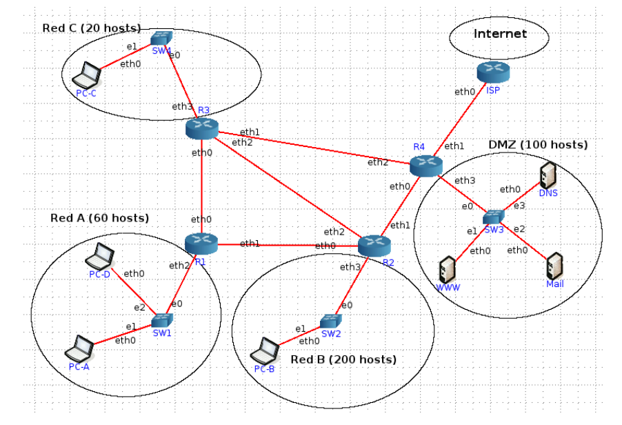

# Redes y Comunicaciones – Parcial 2da fecha – 16/12/2025

**Redes y comunicaciones - 2do semestre - 2da fecha (16/12/2025)**

**1)**

**a)Dado el bloque de red 200.25.128.0/23, asignar redes IP a las redes A, B, C y DMZ.**  
**Red B (200 hosts):**  
Bits de host: me alcanza con 8 bits de host (28 - 2 = 254 hosts)  
Máscara necesaria: /(32-8) = /24 → tengo que moverme 8 bits de derecha a izquierda → me queda 1 bit de subred → al quedarme 1 bit de subred, realizo subnetting en 21 subredes:

**Red: 200.25.128.0/24 → pertenece a Red B**  
Rango usable: 200.25.128.1 - 200.25.128.254  
Broadcast: 200.25.128.255

**Red: 200.25.129.0/24 → pertenece a Red DMZ**

**Red DMZ (100 hosts):**  
Bits de host: me alcanza con 7  
Máscara necesaria: /(32-7) = /25 (entre /24 y /25 me queda 1 bit de subred)  
Realizo subnetting en 21 subredes:

**Red: 200.25.129.0/25 → pertenece a Red DMZ**  
Rango usable: 200.25.129.1 - 200.25.129.126  
Broadcast: 200.25.129.127

**Red: 200.25.129.128/25 → pertenece a Red A**  
**Red A (60 hosts):**  
Bits de host: me alcanza con 6  
Máscara necesaria: /(32-6) = /26

**Red: 200.25.129.128/26 → pertence a Red A**  
Rango usable: 200.25.129.129 - 200.25.129.190  
Broadcast: 200.25.129.191

**Red: 200.25.129.192/26 → pertenece a Red C**

**Red C (20 hosts):**  
Bits de host: 5  
/27

**Red: 200.25.129.192/27 → pertenece a Red C**  
Rango usable: 200.25.129.193 - 200.25.129.222  
Broadcast: 200.25.129.223

**Red: 200.25.129.224/27 → libre**

**b)Listar los bloques de redes libres (sin asignar) y sumarizarlos si es posible.**  
Red: 200.25.129.224/27 → libre  
Rango usable: 200.25.129.225 - 200.25.129.254  
Broadcast: 200.25.129.255

Último octeto de la red C: .192 = 11000000  
Último octeto de la red libre: .224 = 11100000  
Coinciden hasta el bit #2 (en toda la IP, hasta el bit #26) → queda máscara /26

**→ 200.25.129.192/26**

**c)Asignar direcciones de red a las redes restantes de la topología. Para ello, utilizar direccionamiento privado clase B.**  
**Bloque privado clase B: 172.16.0.0/12**

**Enlace P2P R1 - R3:**  
Dos hosts → 2 bits de host (22 - 2 = 2 me alcanza)  
Máscara /30  
**Red 172.16.0.0/30**  
Rango: 172.16.0.1 - 172.16.0.2  
Broadcast: 172.16.0.3

**Enlace P2P R1 - R2:**  
Dos hosts → 2 bits de host (22 - 2 = 2 me alcanza)  
Máscara /30  
**Red 172.16.0.4/30**  
Rango: 172.16.0.5 - 172.16.0.6  
Broadcast: 172.16.0.7

**Enlace P2P R2 - R3:**  
Dos hosts → 2 bits de host (22 - 2 = 2 me alcanza)  
Máscara /30  
**Red 172.16.0.8/30**  
Rango: 172.16.0.9 - 172.16.0.10  
Broadcast: 172.16.0.11

**Enlace P2P R3 - R4:**  
Dos hosts → 2 bits de host (22 - 2 = 2 me alcanza)  
Máscara /30  
**Red 172.16.0.12/30**  
Rango: 172.16.0.13 - 172.16.0.14  
Broadcast: 172.16.0.15

**Enlace P2P R2 - R4:**  
Dos hosts → 2 bits de host (22 - 2 = 2 me alcanza)  
Máscara /30  
**Red 172.16.0.16/30**  
Rango: 172.16.0.17 - 172.16.0.18  
Broadcast: 172.16.0.19

**Enlace P2P R4 - ISP:**  
Dos hosts → 2 bits de host (22 - 2 = 2 me alcanza)  
Máscara /30  
**Red 172.16.0.20/30**  
Rango: 172.16.0.21 - 172.16.0.22  
Broadcast: 172.16.0.23

**d)Asignar direcciones IP a todos los dispositivos de la topología que corresponda.**  
**Red B (200.25.128.0/24):**  
PC-B (eth0): 200.25.128.1  
**Red DMZ (200.25.129.0/25):**  
DNS (eth0): 200.25.129.1  
Mail (eth0): 200.25.129.2  
WWW (eth0): 200.25.129.3  
**Red A (200.25.129.128/26):**  
PC-A (eth0): 200.25.129.129  
PC-D (eth0): 200.25.129.130  
**Red Sumarizada (200.25.129.192/26):**  
PC-C (eth0): 200.25.129.193  
**Enlace P2P R1 - R3 (172.16.0.0/30):**  
R1 (eth0): 172.16.0.1  
R3 (eth0): 172.16.0.2  
**Enlace P2P R1 - R2 (172.16.0.4/30):**  
R1 (eth1): 172.16.0.5  
R2 (eth0): 172.16.0.6  
**Enlace P2P R2 - R3 (172.16.0.8/30):**  
R2 (eth2): 172.16.0.9  
R3 (eth2): 172.16.0.10  
**Enlace P2P R3 - R4 (172.16.0.12/30):**  
R3 (eth1): 172.16.0.13  
R4 (eth2): 172.16.0.14  
**Enlace P2P R2 - R4 (172.16.0.16/30):**  
R2 (eth1): 172.16.0.17  
R4 (eth0): 172.16.0.18  
**Enlace P2P R4 - ISP (172.16.0.20/30):**  
R4 (eth1): 172.16.0.21  
ISP (eth0): 172.16.0.22

**2)Realizar la tabla de ruteo del router R3 considerando:**  
**a)Debe poder llegarse a todas las redes de la topología.**  
**b)La única red que tiene salida a Internet es la red DMZ.**  
**c)Debe tomarse la ruta más corta posible.**  
**d)Sumarizar si es posible y explicar en caso contrario.**

| Red destino | Máscara | Next-hop | Interface |
| --- | --- | --- | --- |
| 200.25.129.192 | /26 | - | eth3 |
| 172.16.0.0 | /30 | - | eth0 |
| 172.16.0.8 | /30 | - | eth2 |
| 172.16.0.12 | /30 | - | eth1 |
| 200.25.129.128 | /26 | 172.16.0.1 | eth0 |
| 172.16.0.4 | /30 | 172.16.0.1 | eth0 |
| 200.25.129.0 | /25 | 172.16.0.14 | eth1 |
| 172.16.0.20 | /30 | 172.16.0.14 | eth1 |
| 200.25.128.0 | /24 | 172.16.0.9 | eth2 |
| 172.16.0.16 | /30 | 172.16.0.9 | eth2 |
| 0.0.0.0 | /0 | 172.16.0.14 | eth1 |

**3)Dado que solamente la red DMZ debe tener salida a Internet y que el router ISP tiene salida a Internet**  
**a)¿En cuáles dispositivos debe configurarse la tabla de rutas para cumplir dicho requisito? Detalle la entrada de la ruta correspondiente para cada dispositivo.**  
Tabla R4:

| Destino | Máscara | Next-hop | Iface |
| --- | --- | --- | --- |
| 0.0.0.0 | /0 | 172.16.0.22 | eth1 |

Tabla ISP:

| Destino | Máscara | Next-hop | Iface |
| --- | --- | --- | --- |
| 200.25.129.0 | /25 | 172.16.0.21 | eth0 |

**4)Suponer que PC-C quiere acceder al recurso http://www.parcial.redes.unlp.edu.ar/index.html y que el servicio web está alojado en el servidor WWW en la red DMZ, DNS (servidor en red DMZ) es el resolver para PC-C y es el servidor autoritativo para el dominio redes.unlp.edu.ar.**  
**Responder:**  
**a)Indicar ordenadamente los requerimientos y sus respectivas respuestas de los protocolos de capa de aplicación implicados que envía y recibe PC-C para poder**  
**acceder al sitio web. Para cada requerimiento y respuesta, indicar la información relevante de cada protocolo.**  
i)  
PC-C hace un DNS Query al servidor DNS sobre el registro A del dominio www.parcial.redes.unlp.edu.ar/index.html  
ii)  
El servidor DNS responde con un DNS Response con la dirección IP del servidor WWW  
iii)  
PC-C pide el requerimiento con un método GET al servidor WWW:  
GET /index.html HTTP/1.1  
Host: www.parcial.redes.unlp.edu.ar  
iv)  
Respuesta HTTP:  
Codigo de estado: 200 OK  
Encabezado: Content-Type:text/html  
Y el codigo HTML correspondiente al recurso

**b)Suponga que se agrega un nuevo subdominio llamado sub.redes.unlp.edu.ar y desea delegarlo en un nuevo servidor con una dirección IP dentro de la red DMZ, ¿qué registros debe agregarse o modificarse en el servidor llamado DNS de la red DMZ?**  
sub.redes.unlp.edu.ar.    IN    NS    ns-sub.redes.unlp.edu.ar.  
ns-sub.redes.unlp.edu.ar. IN    A     200.25.129.36
