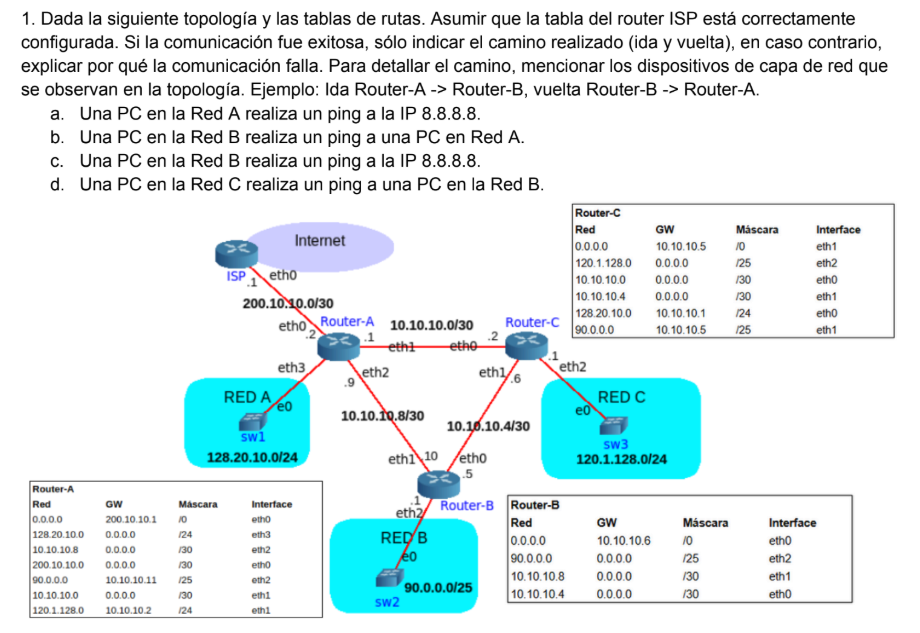
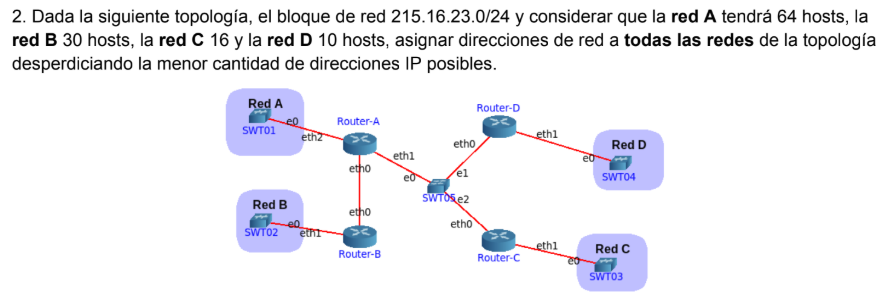
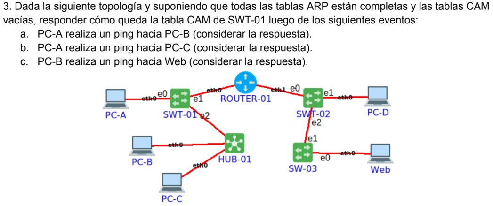
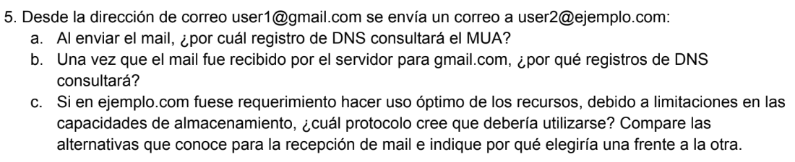
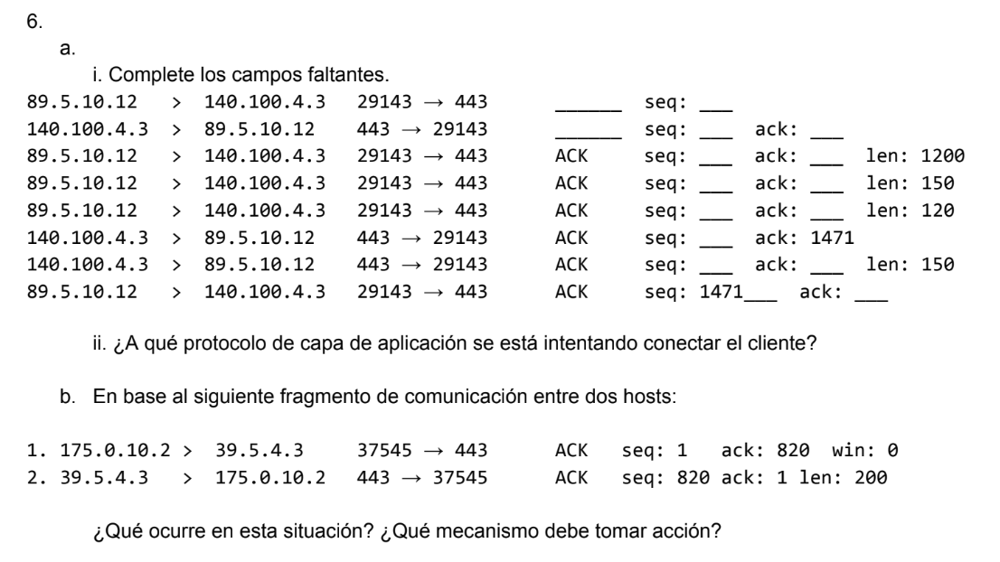
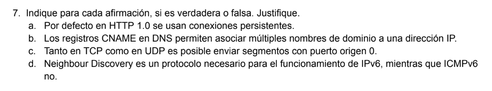

# Redes y Comunicaciones – Parcial 2da fecha – 17/12/2024

a.Ida rtrA → rtrISP → 8.8.8.8, vuelta rtrISP → rtrA → PC\_A  
b.Ida rtrB → rtrC → rtrA → PC\_A, vuelta rtrA → falla. La tabla del router A dice que el gateway para ir hacia la red B (90.0.0.0/25) es 10.10.10.11, pero ese host no existe en la topología.  
c.Ida rtrB → rtrC → rtrB → falla. La comunicación entra en routing loop.  
d.Ida rtrC → rtrB → PC\_B, vuelta rtrB → rtrC → PC\_C

Utilizando VLSM:

- Red A (64 hosts):
  - Bits de host necesarios: 7 (27 - 2 = 126 \>= 64)
  - Máscara: /(32-7) = /25
  - /25 le saca 1 bit de subred a /24. Se desplaza un bit hacia la derecha la barra que separa los bits de red de los de host.
  - Se podrá hacer subnetting en 21 = 2 subredes:
    - 215.16.23.0/25 → Red A
      - Router-A (eth2): 215.16.23.1
      - Rango usable restante: 215.16.23.2 - 215.16.23.126
      - Broadcast: 215.16.23.127
    - 215.16.23.128/25
- Red B (30 hosts):
  - Bits de host necesarios: 5 (25 - 2 = 30 \>= 30)
  - Máscara: /(32-5) = /27
  - /27 le saca 2 bits de subred a /25. Se desplaza 2 bits hacia la derecha la barra que separa los bits de red de los de host.
  - Se podrá hacer subnetting en 22 = 4 subredes:
    - 215.16.23.128/27 → Red B
      - Router-B (eth1): 215.16.23.129
      - Rango usable restante: 215.16.23.130 - 215.16.23.158
      - Broadcast: 215.16.23.159
    - 215.16.23.160/27 → Red C
    - 215.16.23.192/27
    - 215.16.23.224/27
- Red C (16 hosts):
  - Bits de host necesarios: 5 (25 - 2 = 30 \>= 16)
  - Máscara: /27
  - Se utiliza la primer red libre:
    - 215.16.23.160/27 → Red C
      - Router-C (eth1): 215.16.23.161
      - Rango usable restante: 215.16.23.162 - 215.16.23.190
      - Broadcast: 215.16.23.191
- Red D (10 hosts):
  - Bits de host necesarios: 4 (24 - 2 = 14 \>= 10)
  - Máscara: /28
  - /28 desplaza un bit hacia la derecha de /27. Se genera 1 bit de subred.
  - Se podrá hacer subnetting en 21 = 2 subredes:
    - 215.16.23.192/28 → Red D
      - Router-D (eth1): 215.16.23.193
      - Rango usable restante: 215.16.23.194 - 215.16.23.206
      - Broadcast: 215.16.23.207
    - 215.16.23.208/28
- Switch central SWT05 (3 hosts):
  - Bits de host necesarios: 3 (23 - 2 = 6 \>= 3)
  - Máscara: /29
  - /29 desplaza 1 bit a la derecha de /28. Se genera 1 bit de subred.
  - Se podrá hacer subnetting en 21 = 2 subredes:
    - 215.16.23.208/29 → Switch central SWT05 (3 hosts)
      - Router-A (eth1): 215.16.23.209
      - Router-C (eth0): 215.16.23.210
      - Router-D (eth0): 215.16.23.211
      - Rango usable restante: 215.16.23.212 - 215.16.23.214
      - Broadcast: 215.16.23.215
    - 215.16.23.216/29
- Enlace P2P Router-A - Router-B (2 hosts):
  - Bits de host necesarios: 2 (22 - 2 = 2 \>= 2)
  - Máscara: /30
  - /30 desplaza 1 bit a la derecha de /29. Se genera 1 bit de subred.
  - Se podrá hacer subnetting en 21 = 2 subredes:
    - 215.16.23.216/30 → Enlace P2P Router-A - Router-B (2 hosts)
      - Router-A (eth0): 215.16.23.217
      - Router-B (eth0): 215.16.23.218
      - Broadcast: 215.16.23.219
    - 215.16.23.220/30

a.MAC\_PC-A\_eth0 \| e0  
MAC\_PC-B\_eth0 \| e2  
b.MAC\_PC-A\_eth0 \| e0 (refresca el temporizador de la entrada)  
MAC\_PC-B\_eth0 \| e2  
MAC\_PC-C\_eth0 \| e2  
c.MAC\_PC-A\_eth0 \| e0  
MAC\_PC-B\_eth0 \| e2 (refresca el temporizador de la entrada)  
MAC\_PC-C\_eth0 \| e2  
MAC\_ROUTER-01\_eth0 \| e1

a.A  
b.Consultará por MX y A  
c.Debería utilizar POP3. Este es conveniente frente a IMAP ya que su gestión local sin sincronización en la nube lo hace más liviano y reduce la utilización de recursos.

a.  
i.  
SYN \| 0  
SYN,ACK \| 0 \| 1  
1 \| 1  
1201 \| 1  
1351 \| 1  
1  
1 \| 1471  
1471 \| 151

ii.  
HTTPS  
b.Se acabó la ventana que 175.0.10.2 había declarado. Debe tomar acción el mecanismo de control de flujo enviando segmentos de prueba con length = 1 hasta que el cliente restaure el win.

a.Falso. En HTTP 1.0, el comportamiento estándar es utilizar conexiones no persistentes. Esto implica que el servidor cierra la conexión TCP inmediatamente después de enviar la respuesta a una única solicitud. Las conexiones persistentes se estandarizaron y se convirtieron en el comportamiento por defecto recién a partir de la versión HTTP 1.1.  
b.Falso. CNAME es una alternativa para relacionar un nombre de dominio directamente con otro nombre, en vez de relacionarlo con la IP (haciendo IN A) de ese otro.  
c.Falso. El puerto 0 es un puerto reservado y no es válido para su uso en la comunicación real sobre la red.  
Cuando un programa a nivel de sistema operativo intenta vincularse al puerto 0, el sistema interpreta esto como una solicitud para que se le asigne un puerto efímero (dinámico) disponible de forma automática. El segmento que finalmente se transmite tendrá ese puerto efímero asignado, no el 0.  
d.Falso. ICMPv6 es un componente central y obligatorio de IPv6. Además, el protocolo Neighbour Discovery (NDP) depende enteramente de ICMPv6 para funcionar. NDP utiliza tipos específicos de mensajes ICMPv6 (como Router Solicitation, Router Advertisement, Neighbor Solicitation y Neighbor Advertisement) para llevar a cabo sus tareas, como la resolución de direcciones (reemplazando a ARP de IPv4). No puede existir NDP sin ICMPv6.
