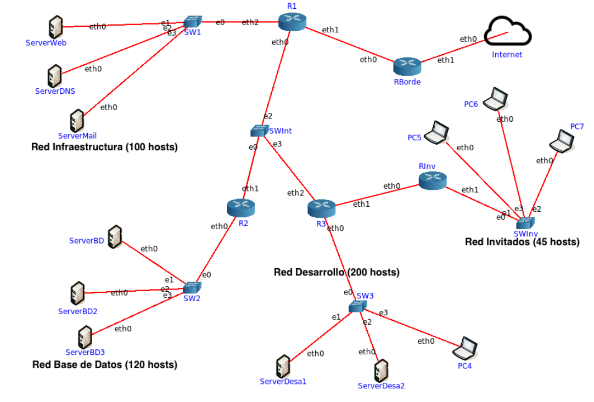
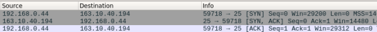
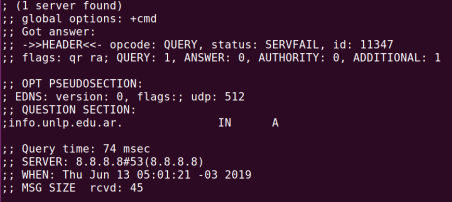
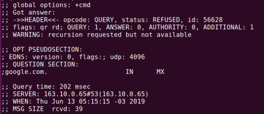

# Redes y Comunicaciones – Parcial 2da fecha – 2019

**Redes y comunicaciones 2019 - Parcial - 2da Fecha.**

1. Dada la siguiente topología de red de la organización **NET-BIO**:

**Aclaraciones**: La dirección MAC de un dispositivo será especificada con el patrón: mac\_id\_iface, por ejemplo, mac\_Pc3\_eth0.

A. Completar la siguiente tabla:

| Red | Es IP de red o IP de host? | IP de red | Clase | Pública / Privada / Reservada |
| --- | --- | --- | --- | --- |
| 1. 170.155.10.1 28/30 | Red | - | B | Pública |
| 2. 10.3.8.11/25 | Host | 10.3.8.0 | A | Privada |
| 3. 10.3.8.209/25 | Host | 10.3.8.128 | A | Privada |
| 4. 10.5.2.0/24 | Red | - | A | Privada |
| 5. 192.168.10.0/ 26 | Red | - | C | Privada |
| 6. 172.16.1.0/28 | Red | - | B | Privada |
| 7. 224.1.1.0/24 | Red | - | D | Reservada |

> 8.127.69.69.0/2

Red

- A  
>   Reservada
>
> 4

1.bits de host: 00 → ip de red  
2.bits de host: 0001011 → ip de host  
ip de red: 10.3.8.(00000000) = 10.3.8.0  
3.bits de host: 1010001 → ip de host  
ip de red: 10.3.8.(00000000) = 10.3.8.0  
4.bits de host: 00000000 → ip de red  
5.bits de host: 000000 → ip de red  
6.bits de host: 0000 → ip de red  
7.bits de host: 00000000 → ip de red  
8.bits de host: 00000000 → ip de red

B. Asignar a los dispositivos del gráfico que corresponda, direcciones IP utilizando las redes de la tabla (columna IP de red), desperdiciando la menor cantidad de ips, teniendo en cuenta las siguientes condiciones:  
Recordar que: *Red infraestructura:* ***100*** *hosts, Red Base de datos:* ***120*** *hosts y Red*  
*Desarrollo:* ***200*** *hosts, Red Invitados:* ***45*** *hosts.*  
1. A red infraestructura, red desarrollo y red Base de datos, se deben asignar redes privadas clase A.  
2. La red entre R1 y RBorde debe tener direccionamiento público de clase C.  
3. El resto de las redes entre routers deben tener direccionamiento privado de clase B.  
4. La red invitados debe tener direccionamiento privado que no sea de clase A ni B.

**Red desarrollo:**  
28 - 2 = 254 → alcanza para 200 hosts  
IP clase A privada óptima: 10.5.2.0/24  
Rango: 10.5.2.1 - 10.5.2.254  
Broadcast: 10.5.2.255

**Red Base de Datos:**  
27 - 2 = 126 → alcanza para 120 hosts  
IP clase A privada óptima: 10.3.8.0/25  
Rango: 10.3.8.1 - 10.3.8.126  
Broadcast: 10.3.8.127

**Red Infraestructura:**  
27 - 2 = 126 → alcanza para 100 hosts  
IP clase A privada óptima: 10.3.8.128/25  
Rango: 10.3.8.129 - 10.3.8.254  
Broadcast: 10.3.8.255

**Red Invitados:**  
26 - 2 = 62 → alcanza para 45 hosts  
IP clase C privada: 192.168.10.0/26  
Rango: 192.168.10.1 - 192.168.10.62  
Broadcast: 192.168.10.63

**Enlace P2P R1 - RBorde:**  
Necesita 2 hosts para los routers → /30

C. Escriba las tablas de enrutamiento de R1 y R3, de modo que haya conectividad completa entre las distintas subredes y entre éstas e Internet.  
2. Observe la siguiente captura de tráfico de la herramienta wireshark y responda.

a. ¿A qué protocolo de la capa de aplicación quieren hacer uso en la captura?  
Hace referencia al protoclo SMTP (puerto 25)  
b. ¿A qué protocolo de capa de transporte corresponde la captura? Justifique.  
Corresponde a TCP. Se debe a que, en este establecimiento de conexión entre los dos hosts, se utiliza el método 3-Way handshake.  
c. ¿Cómo se denominan los primeros tres paquetes de dicha captura?  
3-Way handshake  
d. ¿Cuáles son los distintos tipos de cierres de conexión posibles en este protocolo? Dibuje un diagrama de cada uno.

3. Dadas las siguientes salidas del comando dig, responda:

a. Sobre qué dominio y registro de DNS se le consultó?  
Sobre el registro A del dominio info.unlp.edu.ar  
b. A qué servidor DNS se le consultó?  
Al servidor 8.8.8.8 (servidor DNS primario de Google).  
c. El servidor no respondió la IP consultada. ¿Por qué?  
Esto sucede porque falló. El servidor no fue encontrado. Esto se sabe por el estado SERVFAIL, donde supone que el servidor 8.8.8.8 no puedo conectarse con los servidores DNS autoritativos del dominio unlp.edu.ar.  
d. ¿Podría haber obtenido la respuesta utilizando ese servidor? En caso afirmativo, ¿Qué tendría que haber mandado en la consulta?

e. Sobre qué dominio y qué registro de DNS se le consultó?  
Sobre el registro MX del dominio google.com  
f. A qué servidor DNS se le consultó?  
Al servidor 163.10.0.65 mediante el puerto 53 (puerto default de DNS)  
g. El servidor no respondió la IP consultada. ¿Por qué?  
Ya que el servidor consultado rechazó la consulta.  
h. ¿Podría haber obtenido la respuesta utilizando ese servidor? En caso afirmativo, ¿Qué tendría que haber mandado en la consulta?

4. Si PC 4 envía un PING a ServerWeb (Asuma que todas las tablas de ARP y CAM se encuentran vacías):  
a. Enumere los paquetes ARP intercambiados hasta que el Echo request llega a destino, detallando el valor de sus campos.  
b. Enumere las entradas, respetando el orden en el que se van llenando, de los switch involucrados, una vez que PC4 reciba el Echo reply.

5. Para cada una de las afirmaciones, indique Verdadero o Falso y justifique en ambos casos. a.

El código 304 de respuesta HTTP es que no se encontró el recurso consultado. b. POP corre

sobre UDP y SMTP sobre TCP.

c. SMTP es un protocolo pull.

d. IMAP es el único protocolo de acceso a correo electrónico.

e. A1:B2:C3::E5::FF es una dirección IPv6 válida.

f. Mediante el protocolo ARP puedo obtener la dirección MAC asociada a una IP fuera de mi red.
