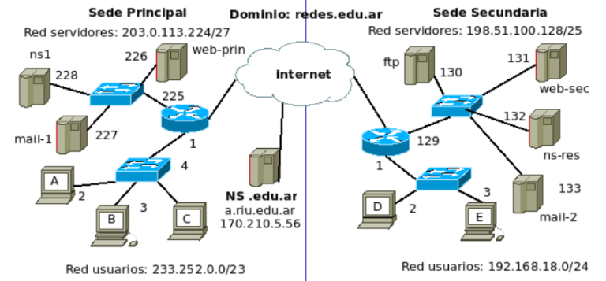
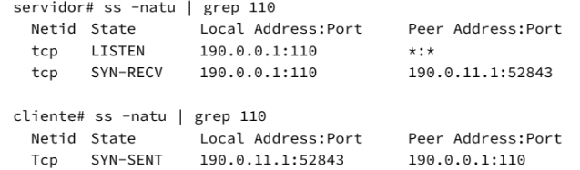
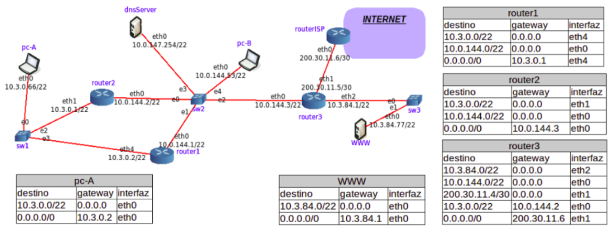

# Redes y Comunicaciones – Parcial 2da fecha – 5/7/2022

**Nombre y Apellido:** \_\_\_\_\_\_\_\_\_\_\_\_\_\_\_\_\_\_\_\_\_\_\_\_\_ **Legajo:** \_\_\_\_\_\_\_\_\_\_\_\_\_\_\_\_\_\_\_\_\_\_\_\_\_  
*Siempre es necesario justificar, las respuestas no debidamente justificadas serán consideradas incorrectas.*  
*En los ejercicios de subnetting deberá ser claro tanto el por qué se selecciona una red y como así también se* *deben dejar expresados los cálculos o explicado el proceso para obtener el resultado. Al comenzar cada* *ejercicio se suponen todas las tablas vacías (CAM, Caché, ARP). Para mencionar la dirección MAC de un* *dispositivo utilice la notación: MAC\_dev\_iface. Ej.: la MAC de pc-B será MAC\_PC-B\_eth0.*

1.La persona encargada de la organización redes.edu.ar requiere de su servicio de consultoría. Le presenta una explicación con un diagrama (Sede Principal y Sede Secundaria).

- **Considerar sobre los DNS servers:**
  - ns1: servidor autoritativo para redes.edu.ar
  - ns-res: servidor resolver interno.
  - a.riu.edu.ar: server autoritativo de la zona edu.ar
- **Considerar sobre web servers:**
  - web-prin: tiene definido 2 sitios web. wp1.redes.edu.ar y wp2.redes.edu.ar.

a.Detalle las configuraciones necesarias en a.riu.edu.ar para hacer alcanzable en Internet el dominio redes.edu.ar.  
Al servidor DNS de a.riu.edu.ar se deben agregar los siguientes registros:

- redes.edu.ar. IN NS ns1.redes.edu.ar
- ns1.redes.edu.ar. IN A 203.0.113.228

b.Explique sí considera que ns1 y ns-res tendrán algún tipo de intercambio DNS.  
Si.

- **El rol de** `ns-res` **(Resolver):** Al ser el servidor resolver interno de la Sede Secundaria, su función es recibir las consultas DNS (recursivas) de los hosts de su propia red (como las computadoras D y E). Si un usuario de la Sede Secundaria quiere acceder a un recurso, su equipo le enviará la consulta primero a `ns-res`.

- **El rol de** `ns1` **(Autoritativo):** Es quien tiene la autoridad y la base de datos oficial con los registros de la zona `redes.edu.ar` (por ejemplo, sabe qué IP tienen `web-prin`, `wp1`, `wp2`, `mail-1`, etc.).

c.¿Por qué SMTP, IMAP y POP para adjuntar una imagen o un ejecutable necesitan aplicar un encoding (ej. base64)?  
Se necesita aplicar un encoding para transformar los datos binarios de 8 bits del archivo adjunto en caracteres  
de texto seguro (ASCII de 7 bits). Esto evita que la información se corrompa o que el protocolo malinterprete fragmentos del archivo como comandos de control.

d.Describa el requerimiento HTTP que se realizaría para acceder al homepage de wp1.redes.edu.ar.  
GET / HTTP/1.1  
Host: wp1.redes.edu.ar

e.Usando FTP Activo, ¿pueden los usuarios D y E intercambiar datos con el servidor FTP?  
Cuando el usuario D o E intenta descargar o subir un archivo mediante FTP Activo, ocurre lo siguiente:  
1.El cliente le enviará al servidor el comando `PORT` informando **su IP privada** (ej. 192.168.18.2).  
2.El servidor FTP recibirá ese comando e intentará iniciar la conexión de datos hacia la IP  
`192.168.18.2`.  
3.Como esa es una IP privada y no es enrutable desde el exterior (o debido a que el firewall/router de NAT bloquea las conexiones entrantes no solicitadas), el servidor **no podrá establecer la conexión de datos** y la transferencia fallará.

2.Dadas las salidas de los siguientes comandos ejecutados en el cliente y el servidor, responder.  
Aclaración: grep es un comando de linux que filtra la salida en pantalla dejando solo aquellas entradas que incluyan la palabra pasada como parámetro. En este caso, sobre la salida de ss -natu, se filtran para mostrar sólo las lineas que contienen 110.

A.¿Qué segmentos llegaron y cuáles se perdieron o están en camino? ¿Qué flags tendría seteado el segmento perdido o en camino?  
Se recibió, por parte del servidor, el segmento del cliente con flag SYN.  
Se perdió/está en camino el segmento por parte del servidor con los flags SYN y ACK, indicandole al cliente que efectivamente recibió su segmento.

B.¿A qué protocolo de capa de aplicación y de transporte se está intentando conectar el cliente?  
El de capa de aplicación es POP3 (email), el de transporte es TCP.

C.Dada la siguiente captura en un host, indique cuál sería la respuesta a los siguientes paquetes observados. (incluya toda la información posible: direcciones IP, puertos, flags y números de secuencia y confirmación):  
a.190.0.11.1.35794 \> 190.0.0.1.110: Flags \[S\], seq 920152, ack 0  
b.127.0.0.1.12345 \> 127.0.0.1.110: Flags \[S\], seq 110012, ack 0  
c.190.0.11.1.45678 \> 192.168.22.1.110: UDP, length 1024  
Respuestas:

- 190.0.0.1.110 \> 190.0.11.1.35794: Flags \[S,A\], seq (ISN), 920153
- 127.0.0.1.110 \> 127.0.0.1.12345: Flags \[S,A\], seq (ISN), ack 110013
- 192.168.22.1 \> 190.0.11.1: ICMP 192.168.22.1 udp port 110 unreachable

3.Dada la sesión TCP de la figura, completar los valores faltantes.

| PC-E | Srv_ImapPop |
| --- | --- |
| Envía 100B Seq. = 1000, ACK = 2000 | → |
| ← | Envía 200B Seq. = 2000, ACK = 1100 |
| Envía 400B Seq. = 1100, ACK = 2200 | → |
| ← | Envía 300B Seq. = 2200, ACK = 1500 |
| Envía 200B Seq. = 1500, ACK = 2500 | → |
| Envía 200B Seq. = 1700, ACK = 2500 | → |
| ← | Envía 100B Seq. = 2500, ACK = 1900 |
| Envía 500B Seq. = 1900, ACK = 2600 | → (se pierde en diagrama original) |
| Envía 300B Seq. = 2400, ACK = 2600 | → |
| ← | Envía 100B Seq. = 2600, ACK = 1900 |
| Envía 500B Seq. = 1900, ACK = 2700 | → |
| ← | Envía 0B Seq. = 2700, ACK = 2700 |

4.Indique la última dirección de red de clase B que está incluida en el siguiente bloque CIDR  
180.96.0.0/11  
La máscara /11 indica que ese bloque de red abarca 232-11 = 221 = 2097152 direcciones.  
/11 = 11111111 11100000 00000000 00000000 = 255.224.0.0  
256 - 224 = 32  
El próximo bloque es 180.(96+32).0.0/11 = 180.128.0.0/11  
La clase B va desde 128.0.0.0 hasta 191.255.255.255  
Entonces a última dirección de red de clase B que está incluida en el bloque 180.96.0.0/11 es 180.127.0.0

5.Usar el bloque 206.58.192.0/19 para generar la mayor cantidad de redes que alojen 700 hosts. Indique la dirección de las primeras 3 subredes.

- Primera subred: 700 hosts

Bits de host necesarios: 10 (210 - 2 = 1022 \>= 700) → máscara /(32-10) = /22

La máscara /22 le saca 3 bits de subred a la máscara /19  
Se realizaría subnetting en 23 = 8 subredes:

- 206.58.192.0/22
  - Rango util: 206.58.192.1 - 206.58.195.254
  - Broadcast: 206.58.195.255
- 206.58.196.0/22
  - Rango util: 206.58.196.1 - 206.58.199.254
  - Broadcast: 206.58.199.255
- 206.58.200.0/22
  - Rango util: 206.58.200.1 - 206.58.203.254
  - Broadcast: 206.58.203.255
- 206.58.204.0/22
- 206.58.208.0/22
- 206.58.212.0/22
- 206.58.216.0/22
- 206.58.220.0/22

6.En base al diagrama de red proporcionado:

A.Indique qué camino toman los paquetes enviados desde pc-A hacia pc-B.

- Va hacia el router1 (cae en interfaz eth4 en 10.3.0.2/22) a traves del sw1
- Va hacia la pc-B (cae en interfaz eth0 en 10.0.144.53/22) a traves del sw2

B.Indique qué camino toman los paquetes enviados desde pc-A hacia WWW.

- Va hacia el router1 (cae en interfaz eth4 en 10.3.0.2/22) a traves del sw1
- Va hacia el router2 ya que no tiene la direccion 10.3.84.77/22 (cae en interfaz eth1 en 10.3.0.1/22) a traves de sw1
- Router2 tampoco tiene una camino especifico hasta WWW, asi que lo manda por su default gateway (10.0.144.3 es router3) a traves de sw2
- Router3 sí tiene el bloque de red (10.3.84.0/22) que contiene a WWW, asi que lo manda mediante sw3 a WWW

C.¿Cómo queda la tabla de asociación del SW2, luego de comunicaciones exitosas entre pc-A y pc-B?

| MAC | PORT |
| --- | --- |
| MAC_router1 | e1 |
| MAC_PC-B | e4 |
| ? | ? |

D.Complete la información del primer ARP-Reply recibido por pc-A. Incluya la información de los protocolos ethernet y ARP de dicha respuesta.
