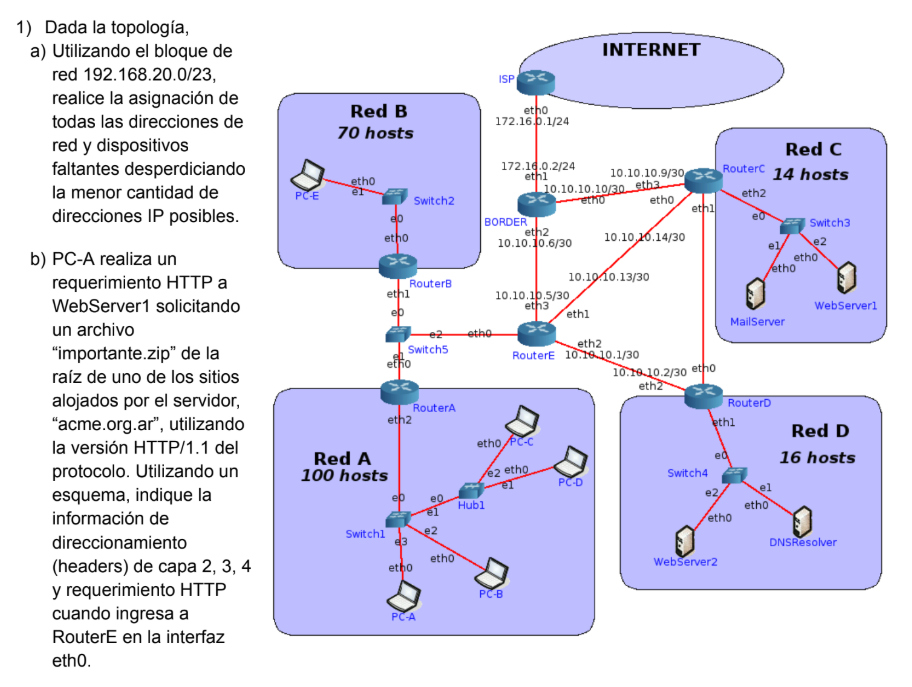
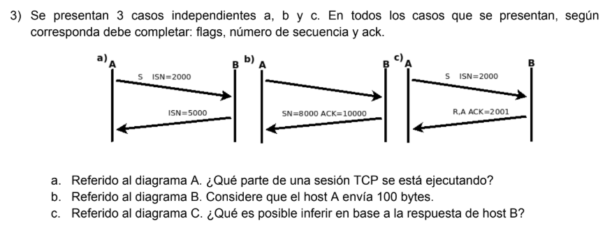

# Redes y Comunicaciones – Parcial 3ra fecha – 7/2/2024

a)192.168.20.0/23

- Red A (100 hosts):
  - Bits de host: 7
  - /25
  - 192.168.0001010\|**0.0** \|0000000  
    /23  /25
  - Se hace subnetting en 4 subredes:
    - 00: 192.168.20.0/25 → Red A
      - RouterA (eth2): 192.168.20.1
      - PC-A (eth0): 192.168.20.2
      - PC-B (eth0): 192.168.20.3
      - PC-C (eth0): 192.168.20.4
      - PC-D (eth0): 192.168.20.5
      - Rango libre: 192.168.20.6 - 192.168.20.126
      - Broadcast: 192.168.20.127
    - 01: 192.168.20.128/25 → Red B
    - 10: 192.168.21.0/25
    - 11: 192.168.21.128/25
- Red B (70 hosts):
  - Bits de host: 7
  - /25
  - Se toma la siguiente red libre:
    - 01: 192.168.20.128/25 → Red B
      - RouterB (eth0): 192.168.20.129
      - PC-E (eth0): 192.168.20.130
      - Rango libre: 192.168.20.131 - 192.168.20.254
      - Broadcast: 192.168.20.255
- Red D (16 hosts):
  - Bits de host: 5
  - /27
  - 192.168.21.0\|**00** \|00000  
    /25  /27
  - Se hace subnetting en 4 subredes:
    - 00: 192.168.21.0/27 → Red D
      - RouterD (eth1): 192.168.21.1
      - DNSResolver (eth0): 192.168.21.2
      - WebServer2 (eth0): 192.168.21.3
      - Rango libre: 192.168.21.4 - 192.168.21.30
      - Broadcast: 192.168.21.31
    - 01: 192.168.21.32/27
    - 10: 192.168.21.64/27
    - 11: 192.168.21.96/27
- Red C (14 hosts):
  - Bits de host: 4
  - /28
  - 192.168.21.001\|**0** \|0000  
    /27 /28
  - Se hace subnetting en 2 subredes:
    - 0: 192.168.21.32/28 → Red C
      - RouterC (eth2): 192.168.21.33
      - MailServer (eth0): 192.168.21.34
      - WebServer1 (eth0): 192.168.21.35
      - Rango libre: 192.168.21.36 - 192.168.21.46
      - Broadcast: 192.168.21.47
    - 1: 192.168.21.48/28
- Red Switch5 (3 hosts):
  - Bits de host: 3
  - /29
  - 192.168.21.0011\|**0** \|000  
    /28  /29
  - Se hace subnetting en 2 subredes:
    - 0: 192.168.21.48/29 → Red Switch5
      - RouterA (eth0): 192.168.21.49
      - RouterB (eth1): 192.168.21.50
      - RouterE (eth0): 192.168.21.51
      - Rango libre: 192.168.21.52 - 192.168.21.54
      - Broadcast: 192.168.21.55
    - 1: 192.168.21.56/29
- Red P2P RouterC - RouterD (2 hosts):
  - Bits de host: 2
  - /30
  - 192.168.21.00111\|**0** \|00  
    /29  /30
  - Se hace subnetting en 2 subredes:
    - 192.168.21.56/30 → Red P2P RouterC - RouterD
      - RouterC (eth1): 192.168.21.57
      - RouterD (eth0): 192.168.21.58
      - Broadcast: 192.168.21.59
    - 192.168.21.60/30

b)

- Capa 2: enlace (antes de pasar por RouterA)  
  1)Trama ethernet:  
  (a)MAC origen: MAC\_PC-A\_eth0  
  (b)MAC destino: FF:FF:FF:FF:FF:FF  
  2)Payload:  
  (a)MAC origen: MAC\_PC-A\_eth0  
  (b)MAC destino: 00:00:00:00:00:00  
  (c) IP origen: 192.168.20.2  
  (d)IP destino: 192.168.20.1
- Capa 2: enlace (luego de pasar por RouterA)  
  1)Trama ethernet:  
  (a)MAC origen: MAC\_RouterA\_eth0  
  (b)MAC destino: MAC\_RouterE\_eth0  
  2)Payload:  
  (a)MAC origen: MAC\_RouterA\_eth0  
  (b)MAC destino: MAC\_RouterE\_eth0  
  (c) IP origen: 192.168.21.49  
  (d)IP destino: 192.168.21.51
- Capa 3: red  
  1)IP origen: 192.168.20.2  
  2)IP destino: 192.168.21.35
- Capa 4: transporte (TCP): luego de hacer el 3-way handshake envía el segmento:  
  192.168.20.2:123 \> 192.168.21.35:80, Flags: \[PSH,ACK\] seq: 1, ack: un\_ack, len: 100
- Requerimiento HTTP:  
  GET /importante.zip HTTP/1.1  
  Host: acme.org.ar

a.  
i.  
Linea que va a la izquierda: flags S,A; ACK=2001  
ii.  
Se está ejecutando el 3-way handshake.  
b.  
i.  
Linea que va a la derecha: flag A; SN=9900, ACK=8000; L=100  
ii.  
Linea que va la izquierda: flag A  
c.  
i.  
Creo que no falta completar nada  
ii.  
Se infiere que el host A quiso establecer una comunicacion mediante 3-way handshake con el host B, pero este no tenia en escucha el puerto solicitado

**4)** Indique la tabla de Ruteo de RouterE, debe llegar a todas las redes de la topología. Eligiendo siempre la ruta más corta y sumarizando siempre que sea posible.

| Destino | Máscara | Gateway | Interfaz | Detalle |
| --- | --- | --- | --- | --- |
| 192.168.21.48 | /29 | - | eth0 | Red Switch5 |
| 10.10.10.4 | /30 | - | eth3 | P2P RE - BORDER |
| 10.10.10.12 | /30 | - | eth1 | P2P RE - RC |
| 10.10.10.0 | /30 | - | eth2 | P2P RE - RD |
| 192.168.20.0 | /25 | 192.168.21.49 | eth0 | Red A |
| 192.168.20.128 | /25 | 192.168.21.50 | eth0 | Red B |
| 172.16.0.0 | /24 | 10.10.10.6 | eth3 | P2P BORDER - ISP |
| 10.10.10.8 | /30 | 10.10.10.6 | eth3 | P2P RBORDER - RC |
| 192.168.21.56 | /30 | 10.10.10.14 | eth1 | P2P RC - RD |
| 192.168.21.32 | /28 | 10.10.10.14 | eth1 | Red C |
| 192.168.21.0 | /27 | 10.10.10.2 | eth2 | Red D |
