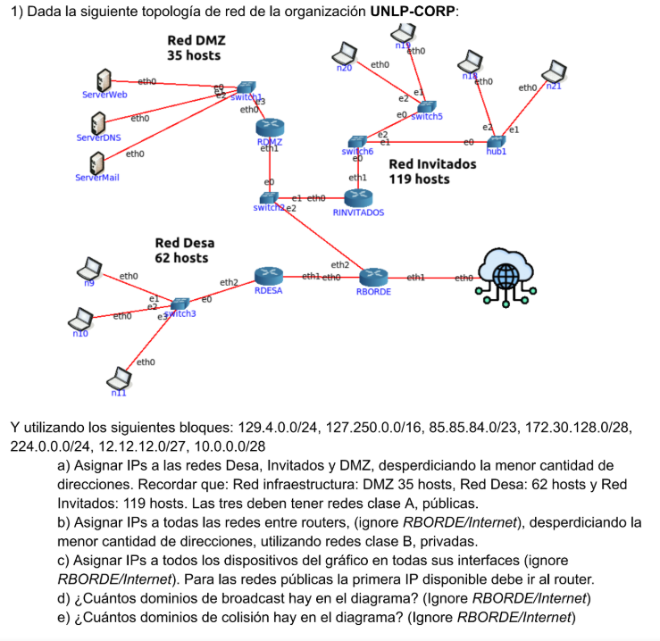
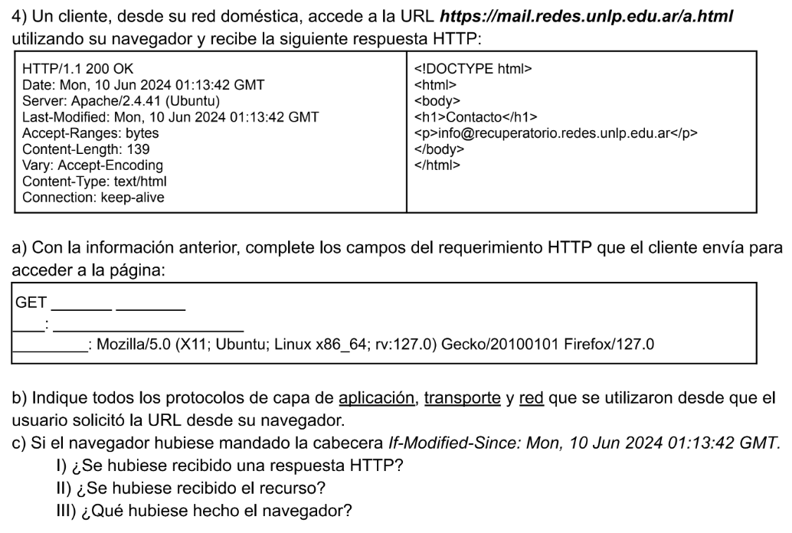
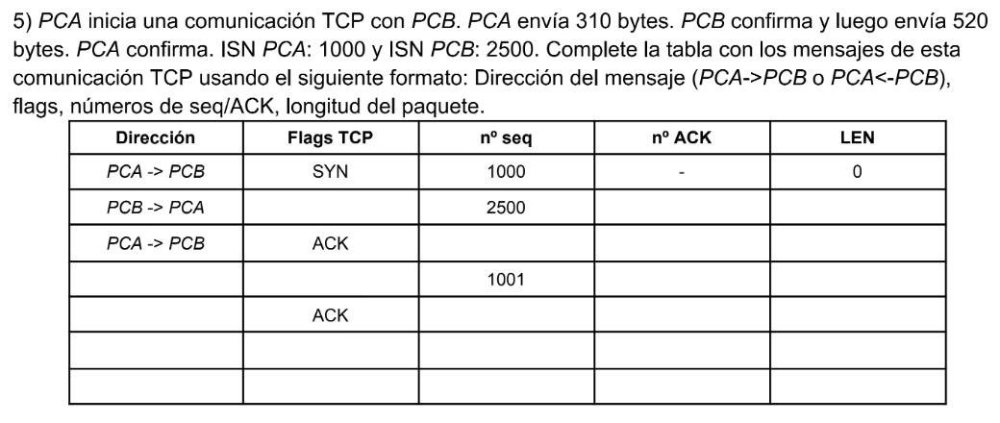
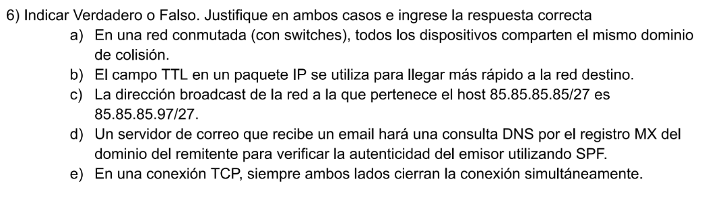

# Redes y Comunicaciones – Parcial 2da fecha – 3/7/2024

a)

- Red invitados (119 hosts):
  - Requiere 7 bits de host (27 - 2 = 126 \>= 119)
  - Requiere máscara /(32-7) = /25
  - Redes publicas de clase A:
    - 85.85.84.0/23 → alcanza
    - 12.12.12.0/27 → no alcanza
  - /25 desplaza 2 bits a la derecha de /23. Se hace subnetting en 22 = 4 subredes:
    - 85.85.84.0/25 → Red Invitados
    - 85.85.84.128/25
    - 85.85.85.0/25
    - 85.85.85.128/25
- Red Desa (62 hosts):
  - Requiere 6 bits de host (26 - 2 = 62 \>= 62)
  - Máscara /26
  - Se toma la red libre 85.85.84.128/25
  - /26 desplaza 1 bit a la derecha la barra que separa bits de ip de bits de host de /25
  - Se puede hacer subnetting en 2 subredes:
    - 85.85.84.128/26 → Red Desa
    - 85.85.84.192/26
- Red DMZ (35 hosts):
  - Requiere 6 bits de host
  - Máscara /26
  - Utilizamos el bloque libre:
    - 85.85.84.192/26 → Red DMZ

b)Se utiliza el bloque 172.30.128.0/28.

- Red switch2 central (3 hosts):
  - Bits de host: 3
  - Máscara: /29
  - /29 desplaza un bit a la derecha la linea que separa bits de ip de bits de host de /28
  - Se hace subnetting en 21 = 2 subredes:
    - 172.30.128.0/29 → Red switch2 central
    - 172.30.128.8/29
- Red P2P RDESA - RBORDE (2 hosts):
  - Bits de host: 2
  - Máscara: /30
  - /30 desplaza un bit a la derecha la linea que separa bits de ip de bits de host de /29
  - Se hace subnetting en 2 subredes:
    - 172.30.128.8/30 →Red P2P RDESA - RBORDE
    - 172.30.128.12/30

c)

- 85.85.84.0/25 → Red Invitados
  - RINVITADOS (eth1): 85.85.84.1
  - Rango libre: 85.85.84.2 - 85.85.84.126
  - Broadcast: 85.85.84.127
- 85.85.84.128/26 → Red Desa
  - RDESA (eth2): 85.85.84.129
  - Rango libre: 85.85.84.130 - 85.85.84.190
  - Broadcast: 85.85.84.191
- 85.85.84.192/26 → Red DMZ
  - RDMZ (eth0): 85.85.84.193
  - Rango libre: 85.85.84.194 - 85.85.84.254
  - Broadcast: 85.85.84.255
- 172.30.128.0/29 → Red switch2 central:
  - RINVITADOS (eth0): 172.30.128.1
  - RDMZ (eth1): 172.30.128.2
  - RBORDE (eth2): 172.30.128.3
  - Rango libre: 172.30.128.4 - 172.30.128.6
  - Broadcast: 172.30.128.7
- 172.30.128.8/30 →Red P2P RDESA - RBORDE
  - RBORDE (eth0): 172.30.128.9
  - RDESA (eth1): 172.30.128.10
  - Broadcast: 172.30.128.11

d)Hay 5 dominios de broadcast. Básicamente, cada red o subred delimitada por las interfaces de los routers es un dominio de broadcast. Si enviamos un paquete de difusión, ¿hasta dónde llega antes de que un router lo frene?  
1.Red DMZ: Todo lo que está conectado a la interfaz eth0 de RDMZ.  
2.Red Desa: Todo lo que está conectado a la interfaz eth2 de RDESA.  
3.Red Invitados: Todo lo que está conectado a la interfaz eth1 de RINVITADOS (incluyendo switch6, switch5 y hub1, el switch deja pasar el broadcast a todos lados).  
4.Red de Infraestructura (Central): La red formada por el switch2 que conecta a RDMZ, RINVITADOS y RBORDE.  
5.Red P2P: El enlace directo entre RDESA y RBORDE.  
e)Hay 17.

2) Implemente la tabla de ruteo de RDMZ. Deben alcanzarse todas las redes de la topología. Sumarizar si es posible.

No se puede sumarizar ya que no existe ningun conjunto de redes con misma máscara y mismo next-hop.

| Destino | Máscara | Gateway (next-hop) | Interfaz | Detalle |
| --- | --- | --- | --- | --- |
| 85.85.84.192 | /26 | - | eth0 | A Red DMZ |
| 172.30.128.0 | /29 | - | eth1 | A switch2 central |
| 85.85.84.128 | /26 | 172.30.128.3 | eth1 | A Red Desa |
| 172.30.128.8 | /30 | 172.30.128.3 | eth1 | A Red enlace P2P RDESA-RBORDE |
| 85.85.84.0 | /25 | 172.30.128.1 | eth1 | A Red Invitados |
| 0.0.0.0 | /0 | 172.30.128.3 | eth1 | Default gateway a internet |

3) Suponiendo que el host n20 realiza una consulta DNS al servidor ServerDNS, describa el primer proceso de solicitud y respuesta ARP que ocurrirá desde el router RDMZ hacia el router RINVITADOS. Indique los detalles de las tramas Ethernet y ARP involucradas.

- El ServerDNS genera la respuesta dirigida a la IP de n20 (85.85.84.4).
- Como n20 está en otra red, el ServerDNS le manda el paquete a su puerta de enlace: el router RDMZ.
- Este, para poder responderle a RINVITADOS, va a dirigir su respuesta, segun su tabla de ruteo, a 85.85.84.0/25, para lo cual necesita pasar por el next-hop 172.30.128.1 (puerto eth1 de RINVITADOS al cual se conecta el switch2 central).
- Al ser este un switch, para armar la trama ethernet y pasarla por cable, RDMZ necesita conocer la MAC de RINVITADOS.
- RDMZ hace un ARP Request para averiguar la MAC de RINVITADOS.
  - Trama ethernet (Capa 2):
    - MAC origen: MAC\_RDMZ\_eth1
    - MAC destino: FF:FF:FF:FF:FF:FF (dirección de Broadcast, RDMZ todavía no sabe la MAC de destino, entonces le pregunta a todos los del switch2)
  - Mensaje ARP (Payload):
    - IP origen: 172.30.128.2
    - MAC origen: MAC\_RDMZ\_eth1
    - IP destino: 172.30.128.1
    - MAC destino: 00:00:00:00:00:00
- RINVITADOS responde un ARP Reply.
  - Trama Ethernet (Capa 2):
    - MAC Origen: MAC\_RINVITADOS\_eth0
    - MAC Destino: MAC\_RDMZ\_eth1
  - Mensaje ARP (Payload):
    - IP Origen: 172.30.128.1
    - MAC Origen: MAC\_RINVITADOS\_eth0
    - IP Destino: 172.30.128.2
    - MAC Destino: MAC\_RDMZ\_eth1

a)GET /a.html HTTP/1.1  
Host: mail.redes.unlp.edu.ar  
User-Agent: Mozilla/…  
b)Capa de aplicación: DNS para conseguir la IP de mail.redes.unlp.edu.ar y HTTP (más específicamente HTTPS) para establecer conexión con el host y solicitar el recurso /a.html.  
Capa de transporte: UDP utilizado por DNS y TCP utilizado por HTTP/HTTPS para conceder una conexión fiable  
Capa de red: IPv4 ya que es el protocolo encargado de rutear los paquetes extremo a extremo a través de internet, desde la red doméstica hasta el servidor de la universidad.  
c)  
i)  
Sí. El servidor siempre contesta. En este caso, devolvería un código de estado 304 Not Modified (en lugar de un 200 OK).  
ii)  
No. Para ahorrar ancho de banda y tiempo, el servidor envía las cabeceras de respuesta pero el cuerpo (el código HTML) viene totalmente vacío.  
iii)  
Al recibir el código 304, el navegador sabe que su copia local está actualizada, por lo que renderiza (muestra) la página a.html directamente desde su memoria caché local.

|  | SYN/ACK | 1001  0 |  |  |
| --- | --- | --- | --- | --- |
|  |  |  | 1001 | 2501  0 |
| PCA → PCB | PSH/ACK | 2501  310 |  |  |
| PCB → PCA    2501 |  |  |  | 1311  0 |
| PCB → PCA | PSH/ACK | 2501 |  | 1311  520 |
| PCA → PCB | ACK | 1311 |  | 3021  0 |

a)Falso. Los switches dividen dominios de colisión. Si hay dispositivos en más de un switch de la red, entonces no todos comparten el mismo dominio de colisión.  
b)Falso. En la capa de red, el TTL (Time to Live) de un paquete IP es un contador de saltos. Su función no es llegar más rápido, sino evitar loops de ruteo infinitos. Cada router que procesa el paquete le resta 1 al TTL; si el TTL llega a 0, el router descarta el paquete y devuelve un mensaje de error ICMP.  
c)Falso. La máscara /27, al terminar en el último octeto de la IP, indica que las redes hacen saltos de 32 en 32: .0, .32, .64, .96, etc. El último octeto .85 cae en la subred que arranca con .64. Entonces la dirección de broadcast sería 85.85.85.95/27.  
d)Falso. Para verificar la autenticidad del emisor usando SPF (Sender Policy Framework), el servidor hace una consulta DNS por un registro de tipo TXT, no un registro MX. Los registros MX (Mail Exchange) se utilizan exclusivamente para saber hacia dónde enviar un correo (rutearlo), no para validar las políticas de seguridad de quién lo emite.  
e)Falso. Contraejemplo: un host cliente quiere enviar un mensaje al puerto X de un host servidor, pero el servidor no tiene ese puerto en estado LISTEN. Entonces el servidor cerraría la conexión enviando el flag RST.
