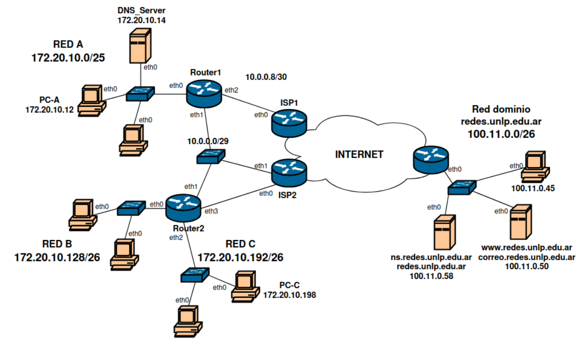
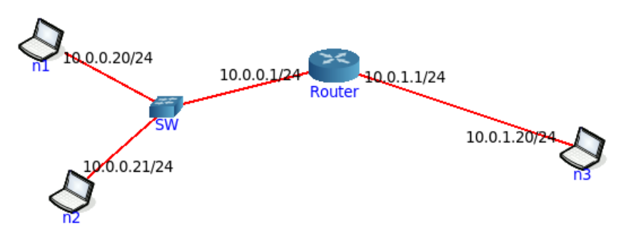
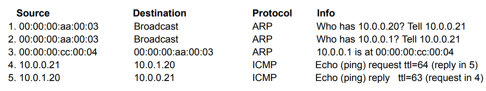

# Redes y Comunicaciones – Parcial 2da fecha – 7/7/2025

**El parcial debe ser resuelto con lapicera de cualquier color. Deberá justificar debidamente todas las respuestas, en caso contrario serán consideradas incorrectas. Además, deberá dejar constancia del procedimiento/análisis que utilizó para llegar a los resultados que presente en cada enunciado demostrando dominio del área evaluada. No debe tener en cuenta ninguna suposición propia por fuera de lo que se enuncia en cada inciso.**  
**Al comenzar cada ejercicio todas las tablas cachés están vacías, salvo que se indique lo contrario.**  
**Para referirse a la dirección MAC de un dispositivo utilice la notación: MAC\_dev\_iface. Ej.: la MAC de una pc “PC-B” será “MAC\_PC-B\_eth0”.**

**Ejercicio 1)**



Diagrama 1

Teniendo en cuenta que servidor **DNS\_Server** es el resolver para RED A, RED B y RED C.

a) ¿Qué registros debe incluir la configuración del servidor DNS **ns.redes.unlp.edu.ar** para el dominio **redes.unlp.edu.ar**?

> Debe incluir los registros…
>
> - A: para traducir el nombre de dominio de redes.unlp.edu.ar y ns.redes.unlp.edu.ar a una direccion IPv4 (100.11.0.58); y también para www.redes.unlp.edu.ar y correo.redes.unlp.edu.ar (100.11.0.50).
>
> ```
> redes.unlp.edu.ar IN A 100.11.0.58
> ns.redes.unlp.edu.ar IN A 100.11.0.58
> www.redes.unlp.edu.ar IN A 100.11.0.50
> correo.redes.unlp.edu.ar IN A 100.11.0.50
> ```
>
> - NS: porque mapea el dominio raíz (redes.unlp.edu.ar) hacia el nombre del servidor DNS encargado de administrarlo (ns.redes.unlp.edu.ar).
>
> ```
> redes.unlp.edu.ar IN NS ns.redes.unlp.edu.ar
> ```
>
> - SOA: para definir los parámetros globales de la zona y declara al servidor primario.
>
> ```
> redes.unlp.edu.ar IN SOA ns.redes.unlp.edu.ar
> ```
>
> - MX: indica a que host enviar los correos dirigidos a @redes.unlp.edu.ar.
>
> ```
> redes.unlp.edu.ar IN MX 10 correo.redes.unlp.edu.ar
> ```

b) Suponga que el host 100.11.0.50 además del dominio **www.redes.unlp.edu.ar** aloja **practicas.redes.unlp.edu.ar**.

i) ¿Cómo indica el cliente con cuál de los dos dominios desea comunicarse? Incluya un ejemplo del requerimiento en HTTP 1.1.

> Lo indica especificando el dominio en la cabecera Host:
>
> GET /index.html HTTP/1.1  
> Host: practicas.redes.unlp.edu.ar

ii) Indicar ip origen e ip destino de los mensajes DNS que **envía y recibe PC-A** para poder resolver el requerimiento anterior.

> DNS Query:  
> IP origen: 172.20.10.12  
> IP destino: 172.20.10.14

> DNS Reply:  
> IP origen: 172.20.10.14  
> IP destino: 172.20.10.14

c) Si un usuario con cuenta de correo **@redes.unlp.edu.ar** quiere recuperar los correos recibidos ¿qué consultas de DNS debe realizar su User-Agent?

> Su User-Agente debe utilizar protocolos pull de acceso a correo como POP3 o IMAP.  
> Entonces debe establecer una conexion al puerto del servidor de correo (110 para POP o 143 para IMAP).  
> Finalmente, necesita traducir ese nombre de host (correo.redes.unlp.edu.ar) a una dirección IPv4, lo cual se logra exclusivamente con un registro de Tipo A.

**Ejercicio 2)**



**Diagrama 2**

En base a la siguiente captura de tráfico realizada en la topología de **Diagrama 2**, sabiendo que no se pierde ningún mensaje:



Indique:  
a) Por cada línea, cómo se va llenando la tabla CAM de SW.

> 1.El switch asocia la PC “n2” a la MAC 00:00:00:aa:00:03 y la asocia en su tabla CAM al puerto físico por donde ingresó la trama desde la PC n2  
> 2.La MAC de origen ya existe en la tabla, simplemente refresca el temporizador de dicha entrada  
> 3.El switch asocia el router a la MAC 00:00:00:cc:00:04 y la asocia en su tabla CAM al puerto físico por donde ingresó la trama desde el router  
> 4.El switch refresca el temporizador de la PC “n2”  
> 5.Aunque el origen es la IP 10.0.1.20 (cuya MAC nunca estará en este switch porque pertenece a otra red), la MAC real que entra en esta linea sería la del router. Entonces el switch refresca el temporizador del router.

b) ¿Qué dispositivo y por cuál interfaz está capturando el tráfico?

> El tráfico está siendo capturado en la PC "n2" (IP 10.0.0.21), a través de su interfaz de red local conectada al switch.  
> Justificación: si observamos las líneas 3, 4 y 5 de la captura, todas implican tramas Unicast en las que el emisor o el receptor físico a nivel de capa de enlace es la MAC 00:00:00:aa:00:03 (la interfaz de n2). Si la captura se estuviera realizando en la PC "n1", por ejemplo, "n1" solo hubiera visto las líneas 1 y 2 (porque son Broadcast), pero jamás habría visto los intercambios unicast de las líneas 3, 4 y 5 debido al filtrado del switch. Además, el patrón demuestra que "n2" es quien inicia toda la comunicación (hace la consulta por n1, luego consulta a su Default Gateway y finalmente emite el Ping).

c) Cantidad de dominios de colisión y de broadcast

> De colisión: los 4 enlaces que hay entre los dispositivos de red  
> De broadcast: las 2 interfaces del router

**Ejercicio 3)** A partir del bloque de red 185.100.60.0/23 asignar direcciones para: Red A (64 hosts), Red B (200 hosts), Red C (45 hosts) y Red D (28 hosts).  
i) Se debe desperdiciar la menor cantidad de direcciones para host posible.  
ii) Indique clase de la dirección de red  
iii) ¿Es una dirección pública o privada?

> **IP del bloque de red: 185.100.60.0**  
> = 10111001 01100100 00111100 00000000  
> **Máscara del bloque de red: /23**  
> = 11111111 11111111 11111110 00000000

> **Red B: 200 hosts**  
> Bits de host: 8 (2^8 = 256)  
> IPs útiles: (2^8) - 2 = 254 → alcanza para los 200 hosts requeridos

> Máscara /23:  
> 11111111 11111111 11111110 00000000  
> Máscara nueva (32 - 8 = 24 unos):  
> 11111111 11111111 11111111 00000000 → /24 (1 bit nuevo para subnettear y 8 bits de host)

> Se divide en 2^1 = 2 subredes:  
> 185.100.60.0/24 → ahora pertenece a la Red B:  
> Es una IP clase B de tipo pública  
> Rango usable: 185.100.60.1 - 185.100.60.254  
> Broadcast: 185.100.60.255

> 185.100.61.0/24 → Red A

> **Red A: 64 hosts**  
> Bits de host: 7 (2^7 = 128). *2^6 = 64 no serviría ya que la red requiere 64 hosts, pero 2 serían robados para* *red y para broadcast.*  
> IPs útiles: (2^7) - 2 = 126 → alcanza para los 64 hosts requeridos

> Tomamos el bloque libre 185.100.61.0/24 para subnettearlo:  
> Máscara /24:  
> 11111111 11111111 11111111 00000000  
> Máscara nueva (32 - 7 = 25 unos):  
> 11111111 11111111 11111111 10000000 → /25 (1 bit nuevo para subnetting y 7 bits de host)

> Se divide en 2^1 = 2 subredes:  
> 185.100.61.0/25 → ahora pertenece a la Red A:  
> Es una IP clase B de tipo pública  
> Rango usable: 185.100.61.1 - 185.100.61.126  
> Broadcast: 185.100.61.127

> 185.100.61.128/25 → Red C

> **Red C: 45 hosts**  
> Bits de host: 6 (2^6 = 64)  
> IPs útiles: (2^6) - 2 = 62 → alcanza para los 45 hosts requeridos

> Tomamos el bloque libre 185.100.61.128/25 para subnettearlo:  
> Máscara /25:  
> 11111111 11111111 11111111 10000000  
> Máscara nueva (32 - 6 = 26 unos):  
> 11111111 11111111 11111111 11000000 → /26 (1 bit nuevo para subnetting y 6 bits de host)

> Se divide en 2^1 = 2 subredes:  
> 185.100.61.128/26 → ahora pertenece a la Red C:  
> Es una IP Clase B de tipo pública  
> Rango usable: 185.100.61.129 - 185.100.61.190  
> Broadcast: 185.100.61.191

> 185.100.61.192/26 → Red D

> **Red D: 28 hosts**  
> Bits de host: 5  
> IPs útiles: (2^5) - 2 = 30 → alcanza para los 28 hosts requeridos

> Tomamos el bloque libre 185.100.61.191/26 para subnettearlo:  
> Máscara /26:  
> 11111111 11111111 11111111 11000000  
> Máscara nueva (32 - 5 = 27 unos):  
> 11111111 11111111 11111111 11100000 → /27 (1 bit nuevo para subnetting y 5 bits de host)

> Se divide en 2^1 = 2 subredes:  
> 185.100.61.192/27 → ahora pertenece a la Red D:  
> Es una IP Clase B de tipo pública  
> Rango usable: 185.100.61.193 - 185.100.61.222  
> Broadcast: 185.100.61.223

> 185.100.61.224/27 → libre

**Ejercicio 4)** Armar la tabla de rutas de **Router1** del **Diagrama 1**. Tenga en consideración que las tablas de los demás routers están completas y que **Router2** tiene como default gateway a **ISP2**.  
a) Asignar direcciones IP a todos los dispositivos del **Diagrama 1**.

> **Red A (172.20.10.0/25):**  
> PC-A (eth0): 172.20.10.12  
> PC generica (eth0): 172.20.10.13  
> DNS Server (eth0): 172.20.10.14  
> Router1 (eth0): 172.20.10.1  
> **Red B (172.20.10.128/26):**  
> PC-B-1 (eth0): 172.20.10.138  
> PC-B-2 (eth0): 172.20.10.139  
> Router2 (eth0): 172.20.10.129  
> **Red C (172.20.10.192/26):**  
> PC-C (eth0): 172.20.10.198  
> PC generica (eth0): 172.20.10.199  
> Router2 (eth2): 172.20.10.193  
> **Switch1 (10.0.0.0/29):**  
> Router1 (eth1): 10.0.0.1  
> Router2 (eth1): 10.0.0.2  
> ISP2 (eth1): 10.0.0.3  
> **Enlace P2P Router1 - ISP1 (10.0.0.8/30):**  
> Router1 (eth2): 10.0.0.9  
> ISP1 (eth0): 10.0.0.10  
> **Enlace P2P Router2 - ISP2 (10.0.0.12/30):**  
> Router2 (eth3): 10.0.0.13  
> ISP2 (eth0): 10.0.0.14

> **Red dominio (100.11.0.0/26):**  
> PC (eth0): 100.11.0.45  
> Server1 (eth0): 100.11.0.58  
> Server2 (eth0): 100.11.0.50  
> Router (eth0): 100.11.0.1

b) Para armar la tabla tenga presentes las siguientes consideraciones:  
i) Deben alcanzarse todas las redes  
ii) Red A debe tener salida a Internet por el router **ISP1**  
iii) Sumarizar en caso de ser posible  
iv) Utilizar la ruta más corta

> **Sumarización:**
>
> - Red B y Red C: son redes contiguas (abarcan desde .128 hasta .255) y comparten el mismo next-hop (router 2):
>   - IP Red B: 172.20.10.182 =
>     - 10101100 . 00010100 . 00001010 . 10110110
>   - IP Red C: 172.20.10.192 =
>     - 10101100 . 00010100 . 00001010 . 11000000
>   - Vemos que coinciden hasta el bit 25 inclusive → armamos el binario poniendo los primeros 25 bits en 1 y los demás en 0:
>     - 11111111 . 11111111 . 11111111 . 10000000
>   - Hacemos AND cualquiera de las IPs y la nueva máscara para obtener la IP sumarizada:
>     - 10101100 . 00010100 . 00001010 . 10110110  
>       &11 111111 . 111 1111 1 . 11111 111 . 10000000  
>       =10101100 . 00010100 . 00001010 . 10000000
>   - Entonces se obtiene la nueva IP sumarizada de las redes B y C: **172.20.10.128/25**
>
> **Tabla de router 1:**

| Destino | Máscara | Gateway | Interfaz |
| --- | --- | --- | --- |
| 172.20.10.0 | /25 | - | eth0 |
| 10.0.0.0 | /29 | - | eth1 |
| 10.0.0.8 | /30 | - | eth2 |
| 172.20.10.128 | /25 | 10.0.0.2 | eth1 |
| 10.0.0.12 | /30 | 10.0.0.2 | eth1 |
| 0.0.0.0 | /0 | 10.0.0.10 | eth2 |

c) Muestre qué cambios debería realizar si se cae el enlace entre **Router1** e **ISP1** para que RED A pueda seguir teniendo salida a Internet. ¿Dónde debería realizar estos cambios?

> Debería modificar el default gateway del router 1, poniendo su next-hop en la IP 10.0.0.3 (ISP2) por la interfaz eth1 o la IP 10.0.0.2 (Router2) también por la interfaz eth1. Esta última opción aprovecha que el Router2 tiene tiene configurado en su tabla a ISP2 como default gateway.

**Ejercicio 5)** Dada la siguiente captura:

192.168.1.110:12576 163.45.10.12:443 \[ \] seq: 3065895943 len:0  
163.45.10.12:443 192.168.1.110:12576 \[ \] seq: 3143359855 ack: 3065895944 len:0  
192.168.1.110:12576 163.45.10.12:443 \[ \] seq: 3065895944 ack: 3143359856 len:0  
192.168.1.110:12576 163.45.10.12:443 \[ A \] seq: 3065895944 ack: 3143359856 len:50  
163.45.10.12:443 192.168.1.110:12576 \[ A \] seq: 3143359856 ack: 3065895994 len:100  
163.45.10.12:443 192.168.1.110:12576 \[ A \] seq: 3143359956 ack: 3065895994 len:20  
163.45.10.12:443 192.168.1.110:12576 \[ A \] seq: 3143359976 ack: 3065895994 len:100  
192.168.1.110:12576 163.45.10.12:443 \[ A \] seq: 3065895994 ack: 3143360076 len:0

a) Complete los datos faltantes  
b) ¿Cuáles Initial Sequence Number (ISN) identifica?  
c) Dentro de lo que se muestra en la captura, ¿detecta algún disparador de control de congestión? Justificar.

> b)Identifico ISN del cliente en la línea 1 = 3065895943 e ISN del servidor en la línea 3 = 3143359856.

> c)No, no detecto ningun disparador de control de congestión. Dado que los números de secuencia y acuse de recibo avanzan en orden, no hay lagunas de datos, no hay retransmisiones visibles y el receptor no se queja de paquetes faltantes, se concluye que la red no presenta congestión ni se disparó ningún mecanismo correctivo.
