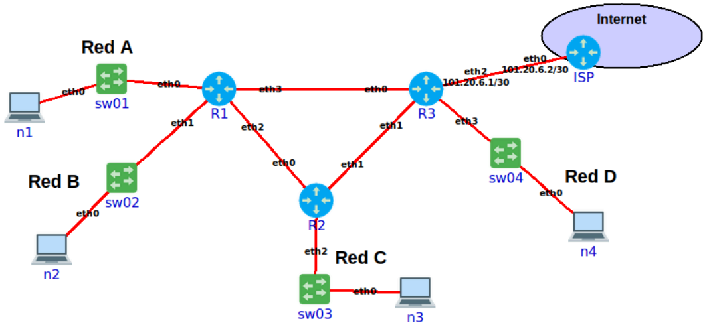
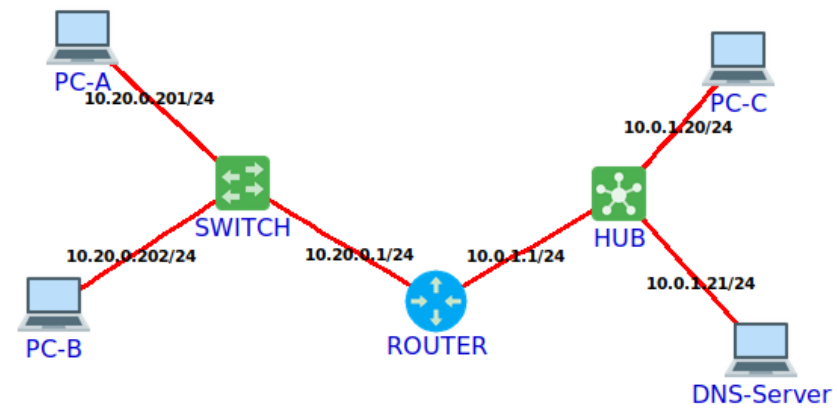

# Redes y Comunicaciones – Parcial 1ra fecha – 23/06/2025

**El parcial debe ser resuelto con lapicera de cualquier color. Deberá justificar debidamente todas las respuestas, en caso contrario serán consideradas incorrectas. Además, deberá dejar constancia del procedimiento/análisis que utilizó para llegar a los resultados que presente en cada enunciado demostrando dominio del área evaluada. No debe tener en cuenta ninguna suposición propia por fuera de lo que se enuncia en cada inciso.**  
**Al comenzar cada ejercicio todas las tablas cachés están vacías, salvo que se indique lo contrario.**  
**Para referirse a la dirección MAC de un dispositivo utilice la notación: MAC\_dev\_iface. Ej.: la MAC de una pc “PC-B” será “MAC\_PC-B\_eth0”.**

**Ejercicio 1)** Dados la siguiente topología y el bloque de red **180.205.10.0/24**, responda:

a) Indique la clase del bloque de red dado. ¿Es un bloque público o privado?  
Es de clase B ya que sus bits más significativos arrancan siendo 10… (es decir, el primer octeto está en el rango 128 - 191). El mismo es público (los primeros dos octetos del rango privado de la clase B van desde 172.16 hasta 172.31).

b) Asignar direcciones de red a todas las redes de hosts de la topología teniendo en cuenta que:  
i) La red A tiene 30 hosts.  
ii) La red B tiene 20 hosts.  
iii) La red C tiene 32 hosts.  
iv) La red D tiene 100 hosts.  
**IP del bloque de red:**  
10110100 11001101 00001010 0000  
**Máscara:**  
11111111 11111111 11111111 00000000

**Aplicando VLSM:**  
**Red D (100 hosts):**  
Bits de host: 7  
IPs útiles: 27 - 2 = 126

Máscara /24:  
11111111 11111111 11111111 00000000  
Máscara nueva /(32-7) = /25:  
11111111 11111111 11111111 10000000 → 1 bit de subred nuevo  
Bloque subdividible entre 21 = 2 direcciones:

- 180.205.10.0/25 → ahora es de Red D
  - Rango usable: 180.205.10.1 - 180.205.10.126
  - Broadcast: 180.205.10.127
- 180.205.10.128/25 → libre

**Red C (32 hosts):**  
Bits de host: 6  
IPs utiles: 26 - 2 = 62

Tomando el bloque libre 180.205.10.108/25  
…

c) Para asignar direcciones de red a las redes entre routers debe utilizar el bloque de red **10.0.0.0/28**.  
Indique la clase del bloque de red. ¿Es un bloque público o privado?  
i) Asignar las direcciones de red en el siguiente orden: R1-R2, R2-R3, R1-R3.

**Ejercicio 2)** Teniendo en cuenta la asignación de direcciones de red del punto anterior,  
a) Armar la tabla de ruteo del router R2 considerando que:  
i) La red C no debe salir a internet.  
ii) Debe poder llegarse a **todas** las redes de la topología.  
iii) Debe elegirse el camino más corto posible.  
iv) Sumarizar siempre que sea posible.  
b) Considerando que el router R3 está configurado como el default gateway de R1, responder:  
i) Indique los cambios que debe realizar en R1 si se cae el enlace entre R1-R3.  
ii) ¿Qué cambios deberían realizarse en R2 para que las redes Red A y Red B sigan teniendo acceso a Internet? ¿Qué implicaría estos cambios respecto al inciso a)?

**Ejercicio 3)** Complete los campos faltantes en el siguiente intercambio TCP:

<pre>IP 192.168.10.5.1234 &gt; 10.0.0.8.80: Flags [<b>S</b>], seq 1000, win 8192, length 0
IP 10.0.0.8.80 &gt; 192.168.10.5.1234: Flags [SA], seq 5021, ack <b>1001</b>,
win 4096, length 0
IP 192.168.10.5.1234 &gt; 10.0.0.8.80: Flags [<b>A</b>], seq <b>1001</b>, ack <b>5022</b>,
win 8192, length 0</pre>

Además, indique:  
a) ¿Hay un proceso escuchando en el host y puerto destino? ¿Qué ocurriría con el intercambio TCP en caso contrario?  
Si, el host `10.0.0.8.80` tuvo que abrir un socket en el puerto 80 en estado LISTEN (apertura pasiva) esperando que algún host establezca una conexión con apertura activa.  
Si el host `10.0.0.8.80` no estaba escuchando, no se habría podido completar el 3-way handshake. El servidor habría rechazado la conexión devolviendo un segmento TCP con el flag RST.  
b) ¿Podría haber un proceso UDP escuchando en el puerto 80 del host 10.0.0.8?  
Si. Los protocolos TCP y UDP se administran de forma independiente y separada. Dado que en un mismo host (como el servidor 10.0.0.8) pueden existir múltiples sockets abiertos y escuchando simultáneamente, el sistema operativo necesita identificarlos de manera unívoca. Para lograr esto, no basta únicamente con mirar el número de puerto, sino que se utiliza una combinación estricta de tres datos fundamentales:

- La Dirección IP (perteneciente a la capa de red).
- El Protocolo de transporte (TCP o UDP).
- El Número de puerto.

La capa de red utiliza el identificador de protocolo 6 para informar que lleva un segmento TCP, y el identificador 17 para indicar que transporta un datagrama UDP  
c) ¿Qué mecanismo debe tomar acción si el tamaño de ventana de uno de los hosts disminuye su valor a 0?  
Debe tomar acción el mecanismo de control de flujo. Este mecanismo evita desbordar el buffer del receptor y desencadena los envíos periódicos de prueba para saber cuándo puede volver a transmitir.

- Detiene el tráfico: El emisor, al recibir una ventana de 0, sabe que la cantidad de datos que puede enviar sin confirmar es cero, por lo que frena el envío de nuevos segmentos.
- Sondeo de Ventana (Window Probes): Si el emisor simplemente se quedara callado, la conexión podría bloquearse para siempre (si el mensaje del receptor avisando que ya tiene espacio se perdiera en la red). Para evitar esto, el control de flujo implementa lo que se conoce como "Envíos periódicos con Byte 0". El emisor envía periódicamente un segmento de prueba muy pequeño para obligar al receptor a responder con un ACK que contenga el tamaño actualizado de su ventana. En cuanto ese ACK indique un tamaño mayor a 0, el emisor reanuda la transmisión normal.

**Ejercicio 4)** Respecto a la siguiente salida del comando dig, responder:

<pre>;; flags: qr aa rd; QUERY: 1, ANSWER: 1, AUTHORITY: 1, ADDITIONAL: 1
;; QUESTION SECTION:
;www.ejemplo.com.ar. IN <b>A</b>
;; ANSWER SECTION:
www.ejemplo.com.ar. 300 IN <b>A</b> 142.251.128.131
;; AUTHORITY SECTION:
ejemplo.com.ar. 300 IN <b>NS</b> ss01.ejemplo.com.ar.
;; ADDITIONAL SECTION:
ss01.ejemplo.com.ar. 300 IN <b>A</b> 216.239.32.10
;; Query time: 31 msec
;; SERVER: <b>216.239.32.10</b>#53</pre>

a) Completar los campos faltantes.

b) Respecto a la respuesta obtenida, ¿es una respuesta autoritativa? ¿Es una respuesta recursiva?  
Si, es una respuesta autoritativa, lo indica el flag aa. Se debe a que el servidor DNS  
(ss01.ejemplo.com.ar) que procesó la consulta es el encargado oficial de esa zona, y no un servidor caché intermediario.  
No, no es recursiva (ya que el flag rd (recursion desired) no está acompañado del flag ra (recursion available)) ni iterativa. El servidor DNS ss01.ejemplo.com.ar no tuvo que consultar por el servidor raiz o TLD que contenga la respuesta a la consulta, ya que la tenía el.

c) ¿Qué función cumple el número 300 en la respuesta? ¿Este valor será diferente si se vuelve a realizar otra consulta al mismo servidor DNS? ¿Por qué?  
El número 300 es el TTL (time to live) del servidor autoritativo. Indica la cantidad de segundos que tienen permitidos otros servidores DNS almacenar en su caché la respuesta que otorga.  
Ese valor no sería diferente si se vuelve a realizar la consulta ya que el servidor que resolvió la consulta (y que tiene el TTL el 300) es el autoritativo. Al ser el servidor autoritativo, tiene el acceso inmediato al recurso que se consulta, es decir, nunca lo guarda en ninguna cache.

d) Indique cómo se vería la configuración necesaria si se desea agregar un servidor de email de nombre **correo.ejemplo.com.ar** y dirección IP `142.251.128.140` al dominio ejemplo.com.ar.

ejemplo.com.ar. IN MX 10 correo.ejemplo.com.ar.  
correo.ejemplo.com.ar. IN A 142.251.128.140  
**Ejercicio 5)** Dada la siguiente topología, suponer que las tablas CAM y ARP están vacías, responder:

a) Indique la cantidad de dominios de broadcast y de colisión que hay en la topología.  
b) ¿Cuáles dispositivos dividen dominios de broadcast? ¿Cuáles dividen dominios de colisión?  
c) Suponer que PC-A realiza una consulta DNS a DNS-Server.  
i) Indicar los datos del ARP Request y de la trama ethernet correspondiente en la red de PC-A. ii) Indicar los datos del ARP Reply y de la trama ethernet correspondiente en la red de PC-A. iii) Indicar los datos de la trama ethernet de la consulta DNS en la red de PC-A.

**Ejercicio 6)** Responder de manera concisa:  
a) Si ejecuta el comando **curl www.redes.unlp.edu.ar/parcial/ejemplo.html**, ¿cómo se vería la línea de requerimiento de esta petición usando la versión de HTTP 1.1?  
GET /parcial/ejemplo.html HTTP/1.1  
Host: www.redes.unlp.edu.ar  
User-Agent: curl/7.xx.x // ni en pedo me acuerdo de esto  
Accept: \*/\*  
Connection: keep-alive

b) ¿Qué protocolos se utilizan para la recepción de mails? Enumere y explique características y diferencias entre las alternativas posibles vistas en la práctica.  
Se utilizan protocolos de envío *push* (SMTP) y protocolos de recepción *pull* (POP3 e IMAP).

- SMTP:
  - Función: Se utiliza en dos momentos: cuando el cliente de correo (MUA) envía un correo nuevo hacia el servidor local (MSA/MTA), y cuando los servidores de correo (MTAs) se transfieren los mensajes entre sí a través de Internet para llegar al destino.
  - Características: Es un protocolo Cliente/Servidor que opera sobre TCP en el puerto 25 (o 587 para el envío inicial desde el cliente). Los comandos viajan en texto plano usando un formato ASCII de 7 bits.
- POP3:
  - Características: Utiliza el puerto TCP 110. Es un protocolo de descarga muy simple y tradicional.
  - Funcionamiento: Su lógica principal es conectarse al buzón, descargar los correos a la computadora local y, por lo general, borrarlos del servidor. No entiende el concepto de "carpetas" en el servidor; es simplemente una bandeja de entrada plana.
- IMAP:
  - Características: Utiliza el puerto TCP 143. Es un protocolo mucho más flexible e inteligente que POP3.
  - Diferencia clave con POP3: IMAP permite el uso de carpetas y la manipulación de los mensajes directamente en el servidor. Con IMAP, el cliente de correo se sincroniza con el servidor. Se puede descargar únicamente los encabezados para ver de qué trata el mail sin gastar ancho de banda descargando todo el cuerpo y sus archivos adjuntos (como se ve en el comando FETCH 1 BODY\[HEADER\]). Si se mueve un mail a una carpeta o se marca como "leído", ese cambio ocurre en el servidor, por lo que si se abre el correo desde otro dispositivo, se verán los mails organizados exactamente igual.
